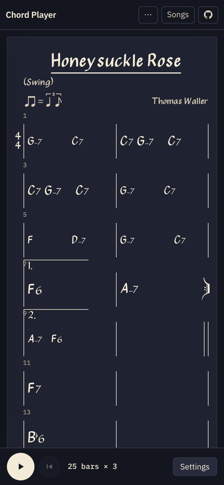
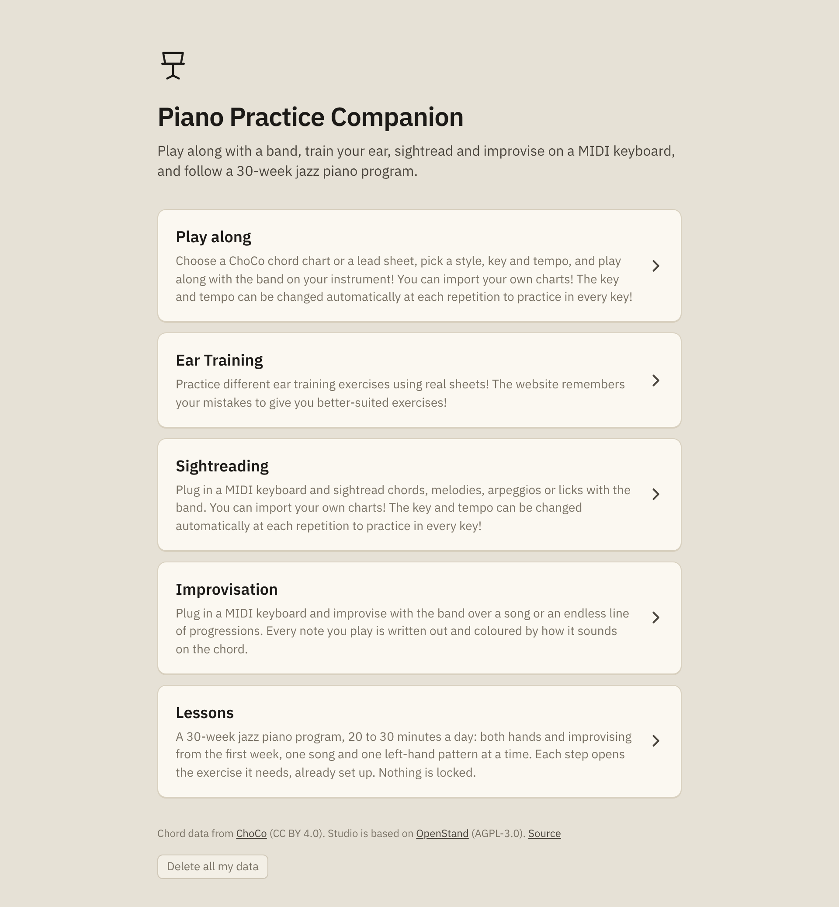
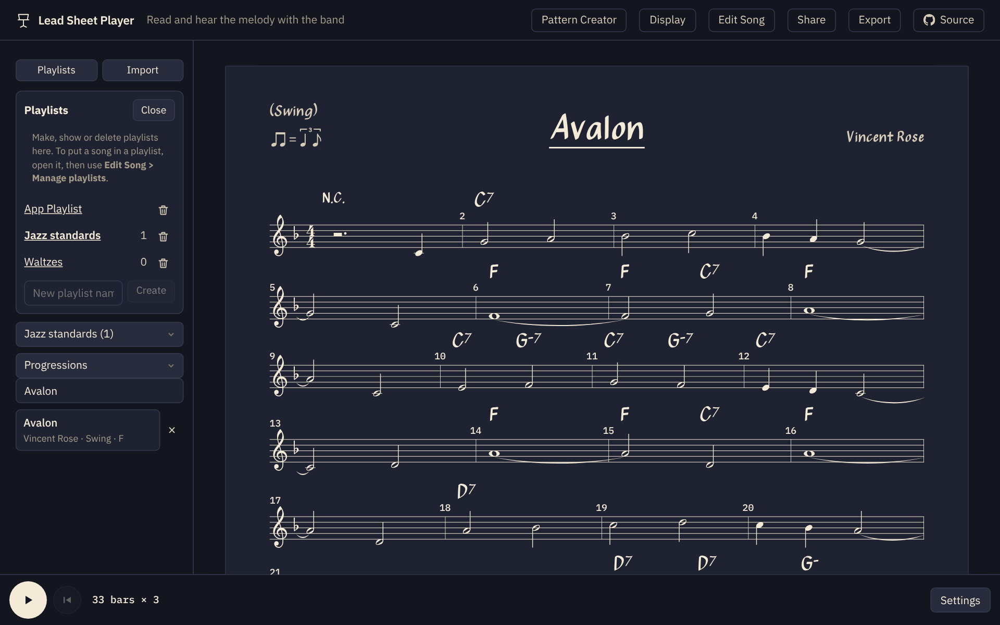
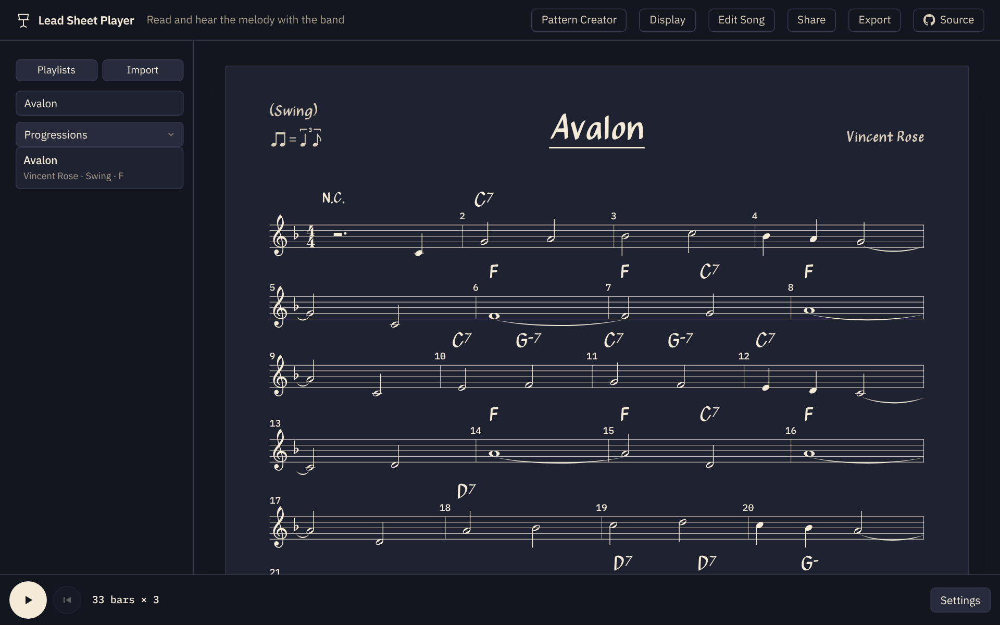
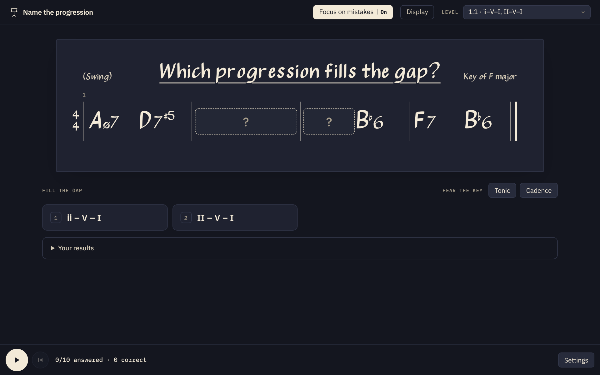
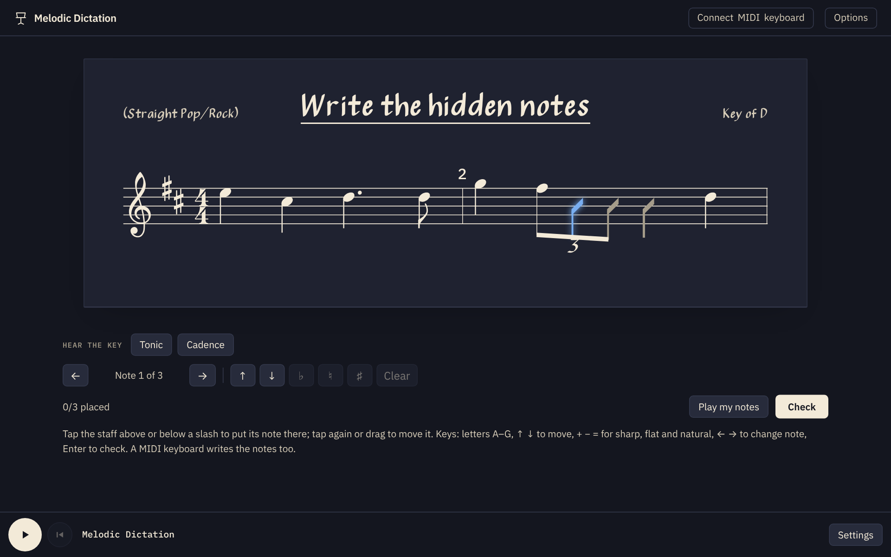
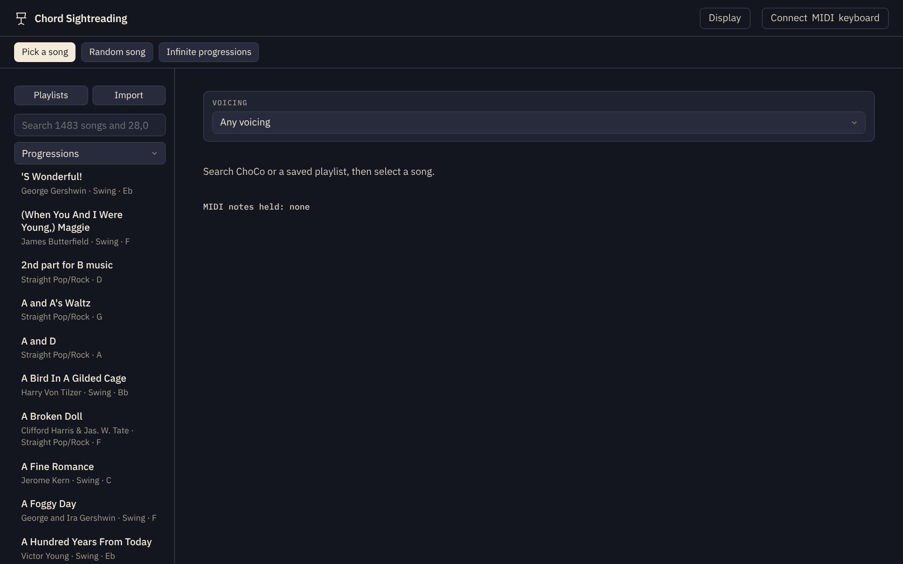
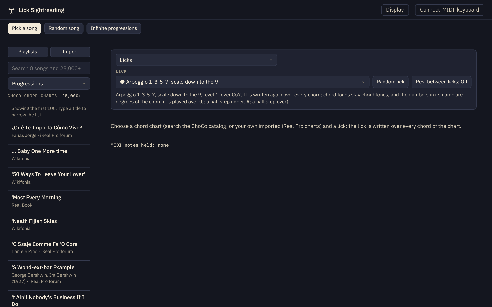
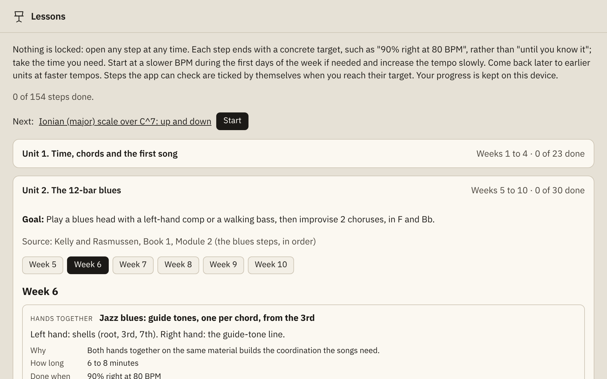

# Piano Practice Companion

An app for practising harmony at the piano with real songs: play along with a band on
**38,307 chord charts**, train your ear to name chord progressions, sight-read
chords and melodies and improvise on a MIDI keyboard, and follow a 46-week
jazz piano program. It runs in a desktop browser and as an Android or iOS app.

The charts come from [ChoCo](https://github.com/smashub/choco), a large open
chord corpus, checked and corrected for this project (see [the data](#the-data)).
The player is a modified version of [OpenStand](https://github.com/canbmaj7/openstand).

**[▶ Try it in your browser](https://dylan-sam.github.io/piano-practice-companion/)**
(no install) · **[Download the Android app](https://github.com/dylan-sam/piano-practice-companion/releases/latest)**




- [What you can do](#what-you-can-do)
- [The data](#the-data)
- [Getting started](#getting-started)
- [Android and iOS apps](#android-and-ios-apps)
- [Publishing the web demo and releases](#publishing-the-web-demo-and-releases)
- [Project layout](#project-layout)
- [Documentation](#documentation)
- [License](#license)
- [Credits](#credits)

## What you can do

The main menu (the home screen) greets you, offers **today's lesson** (the next
step of the Lessons tab, with a Start button that opens its explanation and the
program's progress), then **Practice**: four areas, each opening a menu of its
screens, and the **Lessons** tab; then **your statistics** (streak, time by area,
accuracy in sightreading, ear training, lesson steps and improvisation, where it
counts the notes inside the harmony, and the chords and progressions to work on):

| Area | Screens |
|---|---|
| **Play along** | [Chord Player](#chord-player), [Lead Sheet Player](#lead-sheet-player) |
| **Ear Training** | [Name the progression](#name-the-progression), [Melodic Dictation](#melodic-dictation) |
| **Sightreading** (with a MIDI keyboard) | [Chord Sightreading](#chord-sightreading), [Lead Sheet Sightreading](#lead-sheet-sightreading), [Exercises Sightreading](#exercises-sightreading), [Lick Sightreading](#lick-sightreading) |
| **Improvisation** (with a MIDI keyboard) | [Free Improvisation](#free-improvisation) |
| **Lessons** | [a 46-week jazz piano program](#lessons) whose steps open the screens above, set up for each step |

The back button (and the title at the top left of a screen) goes up one level:
from a screen to its area's menu, then to the main menu; a screen opened from a
lesson step goes back to the Lessons tab.

**Your practice** (kept on the device): days in a row with practice (and the
best run, the hours in all), the minutes of each of the last 7 days, the share
of chords and notes right in sightreading and of answers right in ear training
this week against the week before, the time spent in each area over 30 days,
and what to work on (the chords missed most in Chord Sightreading, the
progression heard wrong most in Name the progression). Time counts while a
practice screen is in use (the band playing, or a key, a click or a MIDI note in
the last minute).

**Appearance** (top right of the home screen): **Dark mode** (the default:
night blue, amber and teal), **Light mode** (cream, coral and teal) or **My
colours** (a theme of your own: background, sheet and panels, text, two accent
colours, the highlighter and the substituted chords, starting from either
mode), and the **effects while playing**: each chord or note judged shows
"Perfect" (on time, within a sixth of a beat), "Good" or "Missed", with the run
of right answers, and a chorus 90% right ends in a burst of colour. Finishing a unit of the Lessons tab also earns a burst. The effects can
be turned off, and the burst never shows when the device asks for reduced
motion.

**Delete all my data**, at the bottom of the main menu, deletes everything the
app keeps on the device (saved and imported songs and playlists, settings,
styles, remembered mistakes, levels passed, lesson progress, practice
statistics, the theme) after a second
confirmation, to start afresh. Other sites served from the same address keep
their data.



### Chord Player

A band (bass, piano, drums) plays any chart of the catalog, or one of your own, so that you can play along !

- **Find a song**: search the 38,307 charts by title, or choose songs that
  contain chosen progressions (a ii-V-I, a I-V-vi-IV...). A song found in
  several collections offers its versions in a menu, the best one first.
- **Arrange it**: seven styles (Swing, Jazz Waltz, Bossa Nova, Latin, Ballad,
  Blues, Straight Pop/Rock), 29 piano patterns, any key, tempo and number of
  choruses. A song in 3/4 starts as a **Jazz Waltz**: ride cymbal and a bass in
  three, the piano comping with Wynton Kelly's waltz figures (from his playing on
  "Someday My Prince Will Come"), or the pattern "bass on 1, chords on 2 and 3".
- **Pattern Creator**: create your own groove on a step grid (drums, bass, comping),
  keep it, share it as a link and use it as a style in your practice.
- **Pause and start again**: the play button pauses the band, and Play goes
  on from the same place (Space too); the button beside it plays from the
  beginning. It works the same in every screen with a band.
- **Chord helper**: tap a chord (a bar of a lead sheet), or the **Chords**
  button beside Practice, to see the chord on a keyboard with the scales to
  improvise with over it: the chord's scale where it is (a V going to a minor
  chord gets its b9 and b13) and its pentatonic; **Show more scales** adds the
  key's pentatonics and blues scale and other good choices (Lydian, bebop
  dominant, altered...). **Follow the chord playing** moves it from chord to
  chord with the band. **Hear** plays the chord or the scale.
- **Substitutions** (beside Practice, on every screen with a band and a song:
  the players, Lead Sheet, Exercises, Lick and Chord Sightreading, Free
  Improvisation): the band plays chosen chord substitutions, drawn in blue on
  the sheet, each described in Roman numerals: the ii added before a long V7
  (V7 → ii−7 V7), a passing diminished chord (I ii−7 → I ♯I°7 ii−7, ii−7 iii−7 → ii−7 ♯ii°7 iii−7), the
  backdoor ii-V (ii−7 V7 I → iv−7 ♭VII7 I), the turnaround with dominants
  (vi−7 ii−7 → VI7 ii−7), the secondary dominant (ii−7 V7 I → II7 V7 I), the
  tritone substitution (any dominant going down a 5th: V7 I → ♭II7 I), the
  altered dominant (V7 I → V7♭9 I, V7 i−7 → V7♭9♭13 i−7). The
  ticked ones apply from the top down, each on the chords the ones above it
  made; drag them to change the order (Turnaround, Secondary dominant, Tritone
  substitution: C A−7 D−7 G7 → C E♭7 A♭7 D♭7). They play every chorus, from a
  chosen chorus on, every other chorus or here and there at random, also in the
  MIDI, WAV and MP3 downloads; on a lead sheet, none goes under a long melody
  note it would clash with. The chord helper shows the chord written under a
  substitute and the substitute's own scales (Lydian dominant over a ♭II7).
  The infinite lines add substitutions on their own, at random (in blue).
- **Start from a chord**: in the chord helper, while the band is stopped or
  paused, **Start the band from here**: the chord is marked and Play starts the
  band there, without a count-in.
- **Practice**: loop a range of bars or a section, go round the keys (up a
  fourth or a fifth, up or down a half step, up a whole step, a minor or a
  major third each chorus, or a random key each chorus, all twelve keys before
  one comes back), speed up each chorus.
- **Swing marking**: a sheet whose style swings its eighths shows the usual
  marking (two eighths = a triplet quarter and eighth) under the style, at the
  top left.
- **Mixer**: volume and mute for bass, piano and drums, a metronome (**Click**,
  muted until you turn it on: a bell on each downbeat, a click on the other
  beats, every dotted quarter in 6/8) and a master volume. **Sync** delays the
  highlight and the judging of your notes when Bluetooth headphones or speakers
  play the band late (0 to 300 ms; a negative value for the other way).
- **Auto-scroll**: while the song plays, a long chart scrolls by itself so the
  yellow highlight stays near the middle of the screen, at a speed set by the
  tempo and the number of beats in a row. It can be turned off in the Display
  menu (Sheet auto-scroller On/Off).
- **Display**: the sheet size (A− / A+, from 70% to 175%, for every chart and
  lead sheet), Roman numerals (each chord as a degree of the key, following key
  changes), minor written C− or Cm, and % for a bar that repeats the bar before.
- **Download the band**: Export > MIDI file, WAV or MP3 audio of the song as
  the band plays it now: style, piano pattern, choruses, practice loop, keys
  and speed-up, and the mixer's levels (a muted part is left out). The audio is
  made in the app (a progress bar, Cancel), with the same sounds and limiter as
  the band you hear.
- **Your own charts**: write or edit a chart (**Edit Song**; a new song is
  saved into a playlist of yours, or a new one), and share a chart as a link
  that opens in this app or in iReal Pro.
- **Playlists**: every song of the app (the study tunes, the OpenEWLD lead
  sheets, the Nottingham folk tunes and the ChoCo chord charts) is in one
  playlist, the **App Playlist**. The song list's buttons are **New**,
  **Playlists** and **Import**; **Playlists** makes your own playlists, shows
  one, or deletes one (with all its songs, only those in no other playlist, or
  none). A song is put in playlists (a song can be in several) with **Edit
  Song > Manage playlists**. In one of your playlists, the × beside a song
  takes it out. A saved song left in no playlist goes to
  "Without playlist". The playlist chooser of the song list appears once you
  have a playlist of your own. Deleting a song of the app, or the whole
  App Playlist, only hides it (the lessons and exercises still
  use it): **Restore all default songs**, on the main menu beside Delete all
  my data, brings it back (and the example exercises of Exercises
  Sightreading, if deleted). A song is deleted with **Edit Song > Delete song**.
- **Edit Song** offers **Manage playlists** (tick or untick the playlists the
  song is in, or make one). Once you change the chart it offers **Save new
  song** instead: the edited chart becomes a new song, saved into the playlist
  you choose, and you go on editing it (your own songs can also be saved in
  place with **Save**).
- **Import** has three choices: iReal Pro links and playlists (MusicXML files
  on the lead sheet screens), **Studio shared links** (paste one or more links
  copied with Share), and a **Studio export** file. Before anything is saved,
  you choose the playlist each part of the import goes into: an existing one,
  or a new one whose name (the iReal Pro playlist's, or the one written in the
  export file) is suggested and can be changed.
- **Export** downloads the playlists you tick, each under a name you can
  change, as a Studio export file (the App Playlist is not
  exported: its songs ship with the app).


- **Lead sheets too**: a lead sheet (see below) opens here as a chord chart,
  and the band plays it without its melody.

### Lead Sheet Player



The same band plays a **lead sheet**: a chart with a melody, drawn on a staff
with the chords above it. The melody plays with the band (alto sax by default,
or the chart's own instrument) and has its own fader in the Mixer.

- **Find a song**: it comes with **1,479 lead sheets that may be shared**: 498 public domain
  songs of the old Wikifonia site (OpenEWLD) and 981 folk tunes of the
  Nottingham Music Database, read and checked as described in
  [Lead sheets shipped with the app](docs/DATA.md#lead-sheets-shipped-with-the-app).
  They also open in the Chord Player, as chord charts.
- The melody follows repeats, loops, transposition and Practice > Keys, with
  the style's swing; every option of the chord player (styles, Practice,
  Pattern Creator, Display) works here too.
- More lead sheets can be imported: a **MusicXML** file (`.musicxml`, `.xml`
  or `.mxl`, as MuseScore exports it, or a scanned or photographed sheet read
  by Audiveris or homr and checked in MuseScore), or a Studio export. A lead
  sheet imported here is also in Lead Sheet Sightreading, and the other way
  round.

### Licks and exercises

Improvisation exercises built in the app, and a curated set of **175 licks**,
all in C and playable in any key, in Exercises Sightreading and Lick
Sightreading ([docs/LICKS.md](docs/LICKS.md)). No note value is shorter than a
sixteenth; eighth-note triplets are used.

- **Exercises**, built from a few settings by the
  [exercise builder](docs/EXERCISES.md#the-exercise-builder) and saved as your
  own presets (six examples ship, one per category): triads and seventh chords
  through the keys (with and without the fifth, 3-5-7-9), guide-tone lines and
  chord-tone lines through ii-V-I in all keys, minor ii-V-i, turnarounds, the
  blues, rhythm changes, the Coltrane cycle and four substitutions (the ii
  added, secondary dominants, the tritone substitution, a passing diminished
  chord), altered dominants (ii-V7♭9-I, minor ii-V7♭9♭13-i) and the minor
  blues, 25 scales and scale patterns, approach notes and enclosures,
  intervals, and rhythm drills.
- **Licks** over a ii-V-I, a minor ii-V-i, a ii-V, a V-I, a turnaround, the
  blues, or one chord: 175, at most 15 per list spread over three levels,
  chosen from the 301 mined from the melodies of the shipped standards and the
  24 written for the project (the 99 mined from folk tunes are not shipped).
  Each mined lick names its tune and bar.

### Name the progression



You hear a line of a real song with a gap in its chart, and choose which
progression fills the gap. The first level asks for the two most common
progressions, and each level adds the next most common progression, based on
how often it appears in the catalog.
A round has 10 questions; 8 right answers pass the level. You can play the
key's tonic or a cadence for reference, hear every answer in the gap once you
have answered, hide the key or every chord, choose the key, and turn on
**Focus on mistakes** to be asked more often what you get wrong.

### Melodic Dictation



You hear a few bars (at most four) of a lead sheet or a lick from the catalog and write the
notes that are hidden. The first and last notes are always shown; the hidden
ones are drawn as slashes, so the rhythm is written for you and only the
pitches are missing. Place a note as in a score editor or play the note using a MIDI keyboard.
In **Options**, choose the number of notes to guess (1 to 12, or all
but the first and last), songs, licks or both, with or without alterations
(notes outside the key signature), whether the chords are written on top of the chart (hidden by
default), whether the band plays along (on by default) and whether placed notes
sound (off by default). You can play the tonic
or a cadence of the key first, and choose the key and tempo.

### Chord Sightreading



Connect a MIDI keyboard (USB or Bluetooth) and play the chords of the chart
while bass and drums play along. A chord turns green when you play it in time,
red when its time runs out. Inversions and octave doublings count, and the
fifth of a four-note chord may be left out. Three modes:

- **Pick a song**: any chart of the catalog or of your playlists. **Import**
  iReal Pro charts or a Studio export here: they are in the Chord Player and
  Lick Sightreading too.
- **Random song**: a random song, if you like one containing a chosen
  progression.
- **Infinite progressions**: an endless line of short progressions chained
  through related keys, with a slider for how often seventh chords appear and
  **Focus on mistakes** for the chords you miss.

**Voicing** turns it into a voicing drill: **Shells** (root, 3rd, 7th), **Two
hands** (a shell under the 9th and 5th), **Rootless** (3rd, 7th, 9th) or
**Quartal** (stacked 4ths from the chord's scale).

### Lead Sheet Sightreading

Read a lead sheet and play its melody on a MIDI keyboard while bass, piano and
drums play the chords. Every note is checked as it goes by: it turns **green**
when you play the right pitch in time, **orange** for a wrong pitch, **red**
when you miss it. The score shows right, wrong and missed notes, extra keys,
the percentage and your average timing (early or late, in milliseconds).

- **Pick a song** or **Random song**, from the 1,479 shipped lead sheets
  (OpenEWLD and Nottingham) and your own imported ones. **Import** MuseScore
  MusicXML files or a Studio export here: they are in the Lead Sheet Player
  too.
- **Scoring** (a button of the bottom bar, next to Practice and Mixer):
  - **Check**: **Melody only** (default), **Chords only** or **Melody and
    chords**, for playing the chords with the left hand under the melody.
    Chords count in any voicing, inversion or rhythm (broken, comped, walking).
    **Melody, hands together**: each note with both hands, an octave apart.
  - **Left hand** (when chords are checked): **Bass note only**, **Whole chord,
    any rhythm** (default), **Whole chord on each beat** or **The piano
    pattern's rhythm**: the stages of learning a song's left hand.
  - **Timing**: Easy, Normal or Strict.
  - **Any octave**: count a note played in another octave than written.
- The band plays the melody too; turn it down or mute it in the **Mixer**.

### Exercises Sightreading


The same screen with the [licks and exercises](#licks-and-exercises) of a few
bars: scales, arpeggios, guide tones, approach notes, intervals, rhythm drills
and licks. **Pick an exercise** or **Random exercise**; the key and tempo can
change at each repetition with the Practice button. **Build exercise**
opens the exercise builder: choose the kind of exercise and its settings (the chord, the
scale, the progression, the key, how it moves through the keys...), and save
it under a name as a preset, listed under its category. A lesson step builds
its own exercise, with its settings locked.

### Lick Sightreading



Choose a **lick** (one of the 133 one-chord licks of the
[database](#licks-and-exercises), or a random one) and where the chords come
from: a chord chart (**Pick a song**: the ChoCo catalog or your own imported
iReal Pro charts, with **Import** here too), **Random song** or **Infinite
progressions** (as in Chord Sightreading). The lick is written and transposed over every chord. Play
it on a MIDI keyboard with the band; it is judged as in Lead Sheet Sightreading.
**Rest between licks** leaves a rest as long as the lick after each one.

### Free Improvisation


Choose a song (the shipped lead sheets, the ChoCo catalog or your own charts), a
**Random song** or **Infinite progressions**, and improvise with the band on a
MIDI keyboard. Every key is written out on the chart as you play and coloured
by how it sits on the chord: chord tone (black), colour tone (green: a note of
the chord's scale, or of the key's pentatonics and blues scale), approach tone
(blue, once you resolve it a half step away), outside (red). The page starts
again at each chorus. Tap a chord for the chord helper and its scales; for a
lesson song, the song's scale ideas part by part sit under the sheet.

### Lessons



A 46-week jazz piano program, about 20 to 30 minutes a day: nine units (the
first song, the blues, the ii-V-I, the minor ii-V-i, song form and Rhythm
Changes, altered dominants, the minor blues, ballad and bossa, modal playing)
and a review. Four units end with a week on a chord substitution (adding the
ii, the secondary dominant, the tritone substitution, the passing diminished
chord), practised then played in the unit's song. Intros and endings come back
on several songs, and each unit's improvising brings one tool to build a solo
(space, rhythm, motifs, tension and release, a shape over choruses). Each week has hands together, a song learnt
with a left hand that grows in stages, a few minutes of improvising and ear
training. Each step's **Start** opens its page: what to do, why, and the
music theory behind it, with scales and voicings on a staff and progressions
with their Roman numerals, drawn in the key you choose (or as Roman numerals)
and heard with **Listen**, and the books it comes from. **Understood, start**
then opens its screen already set up; the back button comes back to the page.
Steps with a target tick themselves when you reach it. Nothing is locked;
progress stays on the device ([docs/LESSONS.md](docs/LESSONS.md)).


All the exercises in detail: [docs/EXERCISES.md](docs/EXERCISES.md).

## The data

The catalog is a SQLite database (`data/progressions.sqlite`) of 38,307 songs
with their keys, time signatures and 2.5 million chords, each chord stored at
its bar and beat with its length. It is built from:

| Source | Songs |
|---|---|
| [ChoCo v1.0.0](https://github.com/smashub/choco/releases/tag/v1.0.0): Wikifonia, Band-in-a-Box (BiaB), Real Book, Nottingham, When in Rome, Rock Corpus, Jazz Corpus, Schubert Winterreise | 15,141 |
| ChoCo's iReal Pro playlists, read from their original `irealb://` links | 2,064 |
| iReal Pro forum charts collected by ChoCo, curated | 23,223 |
| Duplicate and near-identical versions removed | −2,121 |

**How it was curated.** Only chord charts with a key are kept: ChoCo's
audio-based annotations, the collections it licenses for non-commercial use
only and songs without a key are left out. Exact duplicates and versions at
most two chord edits apart are kept once. A forum chart is kept only when it
brings a new song (or is a popular version posted in several threads);
practice exercises, placeholders and charts of fewer than four bars are left
out.

### How the database stores a song

Every song is one row of the `tracks` table (title, artist, composers, genre,
collection, license) and a list of **events** in the `events` table. An event
is a chord, a key or a time signature, and each one is stored with:

| Column | Meaning | Example |
|---|---|---|
| `kind` | what the event is | `chord`, `key` or `timesig` |
| `value` | the chord, key or meter, in one notation for every source ([chord notation](docs/CHORD_NOTATION.md)) | `D:min7`, `C:major`, `4/4` |
| `measure` | the bar number, from 1 (0 for a pickup bar) | `1` |
| `beat` | the beat in that bar, from 1, counted in the meter's own unit: quarter notes in 4/4, eighths in 6/8 or 12/8, so a 12/8 bar has beats 1 to 12 | `3` |
| `onset` | the same position in quarter notes from the start of bar 1, to sort and time events across changes of meter | `2.0` |
| `duration` | the length in quarter notes | `2.0` |
| `ordinal` | the order of the event among the song's chords (or keys, or meters) | `1` |

Bar and beat are two separate numbers, so any beat of any meter can be
written. For example, the start of `| Dm7 G7 | Cmaj7 | Cmaj7 |` in C major,
4/4, is stored as:

| kind | value | measure | beat | onset | duration |
|---|---|---|---|---|---|
| timesig | 4/4 | 1 | 1 | 0 | 12 |
| key | C:major | 1 | 1 | 0 | 12 |
| chord | D:min7 | 1 | 1 | 0 | 2 |
| chord | G:7 | 1 | 3 | 2 | 2 |
| chord | C:maj7 | 2 | 1 | 4 | 8 |

A chord on beat 11 of bar 8 in 12/8 is simply `measure` 8, `beat` 11. Every
source, whatever its own way of writing positions, is converted to this form
when it is read, and the app, the exercises and the progression search only
use this form. Roman numerals are not stored: they are computed from the
chords and the key in force at each chord. More on the layout:
[docs/DATA.md](docs/DATA.md#database-layout).

### What was fixed

ChoCo converts each collection from its original format, and some of these
conversions contain errors. Each collection was checked against its original
source. All the problems below are in **ChoCo's files**, and all the fixes are
made **when those files are read** to build the database (`import_choco.py`
for the ChoCo release, `ireal_playlist.py` for the iReal Pro charts). The
database itself, as described above, has none of these problems. Nothing is
edited by hand, so a rebuild always gives the same result. Each fix gives the
problem, an example, what the import does, and the result in the database.

Only the fixes that concerned more than 100 songs are shown here. Other fixes
were made (chord positions in the Jazz Corpus and in Band-in-a-Box waltzes,
beats 10 to 12 of 12/8 bars, keys of the Jazz Corpus, Nottingham slash chords,
songs without a key or a title, endless tunes...): the details are in
[docs/DATA.md](docs/DATA.md#corrections-to-choco).

#### 1. Chords in the wrong place

**Beat 0 in Band-in-a-Box bars (2,295 songs)**

- **Problem:** some Band-in-a-Box chords on the last beat of a bar are written
  as beat 0 of the next bar. Beats start at 1, so beat 0 does not exist.
- **Example:** in 4/4, `3.0` (bar 3, beat 0) stands for bar 2, beat 4.
- **Fix:** beat 0 of a bar is read as the last beat of the bar before.
- **Now:** the chord sits on bar 2, beat 4.

#### 2. Chords with the wrong length

**Wikifonia, Nottingham, When in Rome, Schubert Winterreise (752 songs)**

- **Problem:** these collections count beats as the music21 library does: in
  6/8, 9/8 or 12/8 a beat is a dotted quarter (three eighths), so a 6/8 bar
  has 2 beats and a 12/8 bar 4. Read in eighths, as the other collections
  are, every length came out three times too short and chords after beat 1
  moved towards the start of the bar. When in Rome gives its lengths in
  quarter notes even in 2/2, where its beats are half notes.
- **Example:** a 6/8 tune with one chord per bar has lengths of "2 beats"
  (the whole bar). Read as 2 eighths, each chord lasted a third of its bar,
  followed by a false "no chord" gap of 4 eighths; a chord on the second beat
  (the fourth eighth) was put on the second eighth. A When in Rome chord of a
  whole 2/2 bar lasted two bars.
- **Fix:** each collection is read with its own way of counting
  (`import_choco.COUNTING`), and lengths are converted bar by bar, so a
  chord that crosses a change of meter is right too.
- **Now:** the 6/8 chord lasts its whole bar (6 eighths), with no gap. In every
  collection, 99 to 100 % of chords start exactly where the one before ends.

**iReal Pro charts (25,287 charts)**

- **Problem:** iReal Pro places chords on a grid of cells, and a chord lasts
  until the next one, as the app plays it. ChoCo ignored the cells and shared
  each bar equally between its chords.
- **Example:** the 4/4 bar `F Abo,G-7` is played by iReal Pro as F for 2
  beats, then Abo and G-7 for 1 beat each. ChoCo gave all three 1 1/3 beats.
- **Fix:** the charts are read again from their original iReal Pro links
  (`irealb://`), cell by cell
  ([details](docs/CHORD_NOTATION.md#chord-lengths-in-ireal-bars)).
- **Now:** F on beat 1 for 2 beats, Abo on beat 3, G-7 on beat 4. When a bar
  really is split evenly (three chords in four beats), the app writes a
  triplet bracket over them.

#### 3. Wrong time signatures

**Real Book (142 songs)**

- **Problem:** ChoCo took each song's time signature from a separate table,
  matched by a number it generated itself, so many songs got another song's
  meter. The chords themselves are always written in bars of 4 beats.
- **Example:** *Belle of the Ball*, a waltz, was in 4/4, and 12 songs in 4/4
  were in 3/4.
- **Fix:** every Real Book song is read in 4/4, except the twelve waltzes of
  ChoCo's own table, whose chords are rescaled to bars of 3 beats (a chord of
  4 beats becomes 3, two chords of 2 beats become 1 1/2 each).
- **Now:** *Belle of the Ball* is in 3/4 and the 4/4 songs are in 4/4.

#### 4. Wrong or missing keys

**Major or minor missing or wrong (Band-in-a-Box, Rock Corpus, Real Book, Wikifonia)**

- **Problem:** Band-in-a-Box and the Rock Corpus give only the key's note (C,
  not C major or C minor). The Real Book and Wikifonia mark many minor songs as
  major: Wikifonia takes its keys from the key signature, which is the same for
  a major key and its relative minor.
- **Example:** a Wikifonia song in C minor (three flats) was labelled E♭
  major; a Band-in-a-Box blues in G minor was just "G".
- **Fix:** the mode is taken from another version of the same song whose mode
  is known (iReal Pro marks it reliably). Otherwise the chords decide: the
  time spent on the major and minor tonic chords (C and Cm), and for
  Wikifonia on the relative minor (Cm in E♭). The thresholds were checked on
  songs whose mode is known (94 to 99 % agreement).
- **Now:** the Wikifonia song is in C minor, the blues in G minor. 821 of
  43,126 keys stay undecided and keep only their note; the app then shows
  "(major or minor)".

#### 5. Wrong chord symbols

**iReal Pro chord symbols (25,287 charts)**

- **Problem:** ChoCo's conversion of iReal Pro charts damaged chord symbols.
- **Example:** `F*maj7*` (a chord with custom text) became `Faj7`, `7alt`
  became `7at`, `Dh7` (D half-diminished) became D♭7, `7#11` gained a ninth,
  and `7b9#9` became a major seventh.
- **Fix:** the charts are read again from their original iReal Pro links with
  this project's own reader (`ireal_playlist.py`).
- **Now:** every chord as written in the chart: Fmaj7, 7alt, Dø7, 7♯11 (no added ninth) and 7♭9♯9 (a dominant chord).

#### 6. Entries that cannot be played

**Grace chords (2,504 chords in 474 songs, mostly Wikifonia)**

- **Problem:** a chord of zero length, followed by another chord at the same
  place. It never sounds, but it showed in the chart and in the exercises.
- **Fix:** it is dropped; an entry left with no chord at all is left out.
- **Now:** only the chord that sounds remains.

**Broken repeat signs (273 forum charts)**

- **Problem:** a repeat sign that is opened but never closed, or closed but
  never opened, makes the chart repeat thousands of times when its repeats are
  written out.
- **Fix:** a chart whose repeats would make it more than four times its
  written length is not imported, and the import log says why.
- **Now:** these charts are left out, and the import log lists them with
  the reason.

Every chord is then written in one notation
([chord notation](docs/CHORD_NOTATION.md)). The full account, with every fix
and the numbers behind it: [docs/DATA.md](docs/DATA.md).

## Getting started

### Requirements

- **Python 3.10** or newer, standard library only (the data and the server).
- **Node.js 22** or newer and **pnpm** (`npm install -g pnpm`) (the app).
- For Chord Sightreading in a desktop browser, a browser with Web MIDI:
  Chrome, Edge or Opera (Firefox asks for a permission; Safari has none).
- About 1 GB of disk space for the ChoCo download and the database.

What Node.js and pnpm are, and how to install them: see the
[tools to install](#android-build-it-yourself) for the Android app, the same for every use.

On Windows, if PowerShell refuses to run `pnpm` ("running scripts is
disabled"), run `Set-ExecutionPolicy -Scope CurrentUser RemoteSigned` once, or
type `pnpm.cmd` instead of `pnpm`.

### 1. Download ChoCo

The database is built from the ChoCo release, too large for this repository.
Download [`v1.0.0.zip`](https://github.com/smashub/choco/releases/download/v1.0.0/v1.0.0.zip)
(187 MB) and save it at the project root as **`choco-v1.0.0.zip`**. The two
other ChoCo files, `choco-ireal-raw-5fe168f.zip` (ChoCo's raw iReal Pro charts)
and `choco-nottingham-bass-5fe168f.zip` (corrected Nottingham basses), are in
the repository.

### 2. Build the data

From the project root:

```sh
python build_database.py        # data/progressions.sqlite (about 2 minutes)
python find_progressions.py     # data/common_progressions.json: the songs of each catalog progression
python build_exercises.py       # studio/public/exercises/: questions of Name the progression
python build_mobile_catalog.py  # studio/public/catalog/: the catalog bundled in the phone apps
```

The files the app reads (`studio/public/exercises/`, `studio/public/catalog/`)
are in the repository, so the phone apps can be built without this step. The
desktop server needs the database.

### 3. Build and run the app

```sh
cd studio
pnpm install
pnpm run build
cd ..
python server.py                # or double-click start.bat on Windows
```

The app opens at <http://127.0.0.1:8765/>. While changing the app, run
`pnpm run dev` in `studio/` for live reload, with `server.py` running for the
song search.

### Tests

```sh
python -m unittest discover     # the data pipeline, from the project root
cd studio
pnpm test                       # the app (vitest)
pnpm run lint
npx playwright install chromium # once, for the browser tests
pnpm run test:e2e               # the browser tests (Playwright) on the built app
```

The browser tests (`studio/e2e/`) open every screen on a computer and on phones
held both ways, and check what is easy to break by hand: a style or band change
that must not restart the song, endless lines going from sheet to sheet, notes
placed in Melodic Dictation, the Export menu. GitHub runs the types, lint, unit
tests and browser tests on every push (`.github/workflows/tests.yml`).

### Adding your own iReal Pro playlists

Put iReal Pro playlist files (`.txt` or `.html` with `irealb://` links, as
iReal Pro exports them) in `data/ireal-playlists/` and build the data again
(step 2). Their songs join the catalog as "iReal Pro playlists". The app can
also import playlists itself (**Import** in the Chord Player); those
are kept in your browser only.

## Android and iOS apps

The phone apps are the same app in a native shell made with
[Capacitor](https://capacitorjs.com) 8, with the song catalog bundled (no
server needed) and native MIDI input over USB and Bluetooth.

### Android: install the ready-made APK

The quickest way to get the app on an Android phone (Android 7.0 or newer),
with nothing to build:

1. On the phone, open the
   [latest release](https://github.com/dylan-sam/piano-practice-companion/releases/latest)
   and tap `piano-practice-companion-debug.apk` (22 MB) under **Assets**. The
   same file is also in the repository, at
   [`releases/piano-practice-companion-debug.apk`](releases/piano-practice-companion-debug.apk)
   (open the link, then **Download raw file**).
2. Open the downloaded file. Android asks to allow installing apps from your
   browser or file manager: allow it for that app, then tap **Install**.
3. The app appears as **Ear Training** among your apps.

This APK is a test build of the latest version, signed with a development key
rather than a Play Store key, so Android may warn that the app is from an
unknown developer. To update it, install the newer APK over the old one; if
Android refuses because the signature differs, uninstall the old app first
(your saved tunes and settings are then lost: export your playlists before).

### Android: build it yourself

**Tools to install first** (once):

1. **Node.js 22 or newer** from [nodejs.org](https://nodejs.org) (take the LTS
   version). Node.js runs the JavaScript tools that build the app. Check it in a
   new terminal with `node --version`.
2. **pnpm**, the package manager this project uses. A package manager
   downloads the libraries the app is built with (React, Vite, Capacitor and
   about 300 others) into `studio/node_modules/`, at the exact versions listed
   in `studio/pnpm-lock.yaml`, and runs the project's commands
   (`pnpm run build`...). It does the same job as npm, which comes with Node.js,
   but is faster and saves disk space. Install it with npm:

   ```sh
   npm install -g pnpm
   pnpm --version
   ```

   (`corepack enable pnpm` works too.) On Windows, if PowerShell answers that
   running scripts is disabled, run
   `Set-ExecutionPolicy -Scope CurrentUser RemoteSigned` once, or type
   `pnpm.cmd` instead of `pnpm`.
3. **Python 3.10 or newer** from [python.org](https://www.python.org)
   (on Windows, tick "Add python.exe to PATH" in the installer). The build
   uses it to pack the app's source code.
4. **[Android Studio](https://developer.android.com/studio) 2025.2.1 or
   newer.** It includes the Java the build needs (JDK 21) and downloads the
   Android SDK. On its first start, accept the standard setup, and install
   the SDK platform 36 when it asks. Uninstall older Android Studio versions,
   or Gradle may find their old Java.

**Build the app**, from `studio/`:

```sh
pnpm install
pnpm run native     # rebuilds the phone catalog and the app, and copies them into android/ and ios/
pnpm run android    # opens the project in Android Studio
```

Without the database (step 2 skipped), run `pnpm run sync` instead of
`pnpm run native`: it uses the catalog already in `studio/public/catalog/`.

In Android Studio, wait for the Gradle sync to finish, then choose
**Build → Build Bundle(s) / APK(s) → Build APK(s)**. The APK is written to
`studio/android/app/build/outputs/apk/debug/app-debug.apk`: copy it to your
phone and open it (allow installing apps from that source), or connect the
phone with USB debugging on and press **Run**. A Play Store release needs a
signed bundle (**Build → Generate Signed Bundle / APK**).

Run `pnpm run native` (or `pnpm run sync`) again after every change to the app
or the data, before building. Command-line builds and common errors (Java
version, `JAVA_HOME`, PowerShell): [docs/MOBILE.md](docs/MOBILE.md#building).

### iOS (not tested yet)

The Xcode project is in `studio/ios` but has never been built. You need a Mac
with **Xcode 26** or newer and its command line tools
(`xcode-select --install`), and an Apple account to sign the app. The app
targets iOS 15 and later and uses Swift Package Manager (no CocoaPods). From
`studio/`:

```sh
pnpm install
pnpm run native
pnpm run ios        # opens the project in Xcode
```

In Xcode, choose your team under **Signing & Capabilities**, pick a device or a
simulator, and press **Run**. The first build is also the first compile of the
MIDI plugin (`ios/App/App/MidiPlugin.swift`), so expect to fix small errors.
Publishing on the App Store raises a license question: see [License](#license).

How the bundled catalog, native MIDI and phone layouts work:
[docs/MOBILE.md](docs/MOBILE.md).

## Publishing the web demo and releases

Two GitHub Actions workflows publish the app (`.github/workflows/`):

| Workflow | Runs when | Does |
|---|---|---|
| `pages.yml` (Web demo) | every push to `master`, or by hand (Actions → Web demo → Run workflow) | builds the app with the song catalog bundled (`VITE_BUNDLED_CATALOG=1`, no server needed) for the folder `/piano-practice-companion/`, and publishes it on GitHub Pages |
| `tests.yml` (Tests) | every push and pull request | checks the app's types and lint, runs the unit tests, then the browser tests on the app built as for the web demo |
| `release.yml` (Release) | a version tag is pushed (`v1.0.0`, `v1.1.0`...) | creates a GitHub release with `releases/piano-practice-companion-debug.apk` attached, and the notes of `releases/<tag>.md` (or a list of the commits when there is no such file) |

The web demo needs GitHub Pages turned on once: **Settings → Pages → Build and
deployment → Source: GitHub Actions**. To publish a new release, rebuild the APK,
copy it to `releases/piano-practice-companion-debug.apk`, write its notes in
`releases/v1.1.0.md`, commit, then:

```sh
git tag v1.1.0
git push origin master v1.1.0
```

The app can be served from any folder: `BASE_PATH=/my-folder/ pnpm run build`
builds it for `https://example.org/my-folder/` (add `VITE_BUNDLED_CATALOG=1`
when there is no `server.py` behind it).

## Project layout

```
build_database.py        builds data/progressions.sqlite from the sources in data/sources.json
import_choco.py          reads the ChoCo release and corrects its errors
ireal_playlist.py        reads irealb:// charts (repeats, cells) and curates the forum charts
track_store.py           writes songs to the database; settles key modes (key_modes.py)
song_dedupe.py           removes duplicate and near-identical versions
chord_notation.py        the chord, key and Roman numeral notation used everywhere
score_timing.py          bar and beat positions in every meter
common_progressions.py   the catalog progressions; find_progressions.py finds them in the songs
build_exercises.py       questions of Name the progression
build_mobile_catalog.py  the catalog bundled in the phone apps
build_nottingham_fix.py  rebuilds the Nottingham correction file from the ChoCo repository
weimar_playlist.py       turns Weimar Jazz Database solos into lead sheets in weimar/ (test files, not shipped, not in git)
left_hand_patterns.py    the piano patterns (data/left_hand_patterns.json)
server.py                serves the app and the song search on http://127.0.0.1:8765/
score_search.py          song search, versions and their order
studio_bridge.py         turns a song of the database into an app chart
tests/                   Python tests
data/                    sources list, licenses; the database and catalogs once built
weimar/                  Weimar Jazz Database solos and licks for testing (made locally, not in git)
docs/                    documentation and screenshots
studio/                  the app (React, TypeScript, Vite) and its Android and iOS projects
  src/engine/            arranges a chart into MIDI: bass, piano, drums, melody
  src/audio/             synthesizer (SpessaSynth), mixer, MIDI input
  src/music/             chords, charts, melodies and their ABC notation, Roman numerals, practice
  src/exercises/         Name the progression, Melodic Dictation, Chord, Lead Sheet, Exercises and Lick Sightreading
  scripts/               builds the shipped lead sheets and the licks and exercises (docs/LICKS.md)
  src/ui/                screens and controls
  src/formats/           iReal Pro import and export, share links
  tests/                 app tests
```

## Documentation

- [docs/DATA.md](docs/DATA.md): sources, database layout, curation, every correction, rebuilding.
- [docs/CHORD_NOTATION.md](docs/CHORD_NOTATION.md): how chords are written, read from iReal Pro cells and played.
- [docs/EXERCISES.md](docs/EXERCISES.md): Name the progression, Melodic Dictation, the four sightreading screens and Free Improvisation in detail.
- [docs/LESSONS.md](docs/LESSONS.md): the Lessons tab, its program, links and sources.
- [docs/LICKS.md](docs/LICKS.md): the licks and exercises, how they are made and mined, and their rights.
- [docs/MOBILE.md](docs/MOBILE.md): the Android and iOS apps, building and troubleshooting.
- [studio/README.md](studio/README.md): the app, its styles and piano patterns.
- [PATTERN_AUDIT.md](PATTERN_AUDIT.md): the piano patterns and their sources.
- [AGENTS.md](AGENTS.md): coding conventions for contributors.

## License

**Code: [GNU AGPL-3.0-or-later](LICENSE).** The app is a modified version of
OpenStand, which is under the AGPL, so the app and the rest of this project's
code are too. You may use, change and share it, also commercially, as long as
everyone who uses your version, including over a network, can get its source
code under the same license. The app links to its own source (`source.zip`)
for that reason.

**Data: [CC BY 4.0](data/LICENSE.md).** The database and the catalogs built
from it (`data/`, `studio/public/catalog/`, `studio/public/exercises/`) are
adapted from ChoCo, which is under CC BY 4.0: you may share and adapt them,
also commercially, if you credit ChoCo (see [Credits](#credits)). The ChoCo
collections licensed for non-commercial use only (CASD, JAAH, Mozart Piano
Sonatas) are not included. The iReal Pro forum charts were contributed by forum
users and are distributed by ChoCo. The catalog holds chord symbols, titles,
composers and keys only: no melodies, lyrics or recordings.

**Licks** ([docs/LICKS.md](docs/LICKS.md#rights-and-credits)): the exercises,
the vocabulary and the folk licks in `studio/public/licks/licks.json` are
CC BY 4.0, the licks from standards public domain. The licks mined from the
Weimar Jazz Database (ODbL 1.0) are not shipped: they are built only in the
`weimar/` folder of your own copy, which git ignores.

**Libraries, sound bank and fonts** keep their own licenses: abcjs (MIT), GeneralUser GS
(`studio/public/soundfonts/GeneralUser-GS-LICENSE.txt`, free to use, also
commercially), Petaluma (`studio/src/assets/fonts/Petaluma-OFL.txt`) and IBM
Plex, both under the SIL Open Font License.

Apple's App Store terms are generally held to be incompatible with the AGPL:
publishing the iOS app there would need the agreement of the OpenStand
authors. Google Play has no such restriction. This is not legal advice.

## Credits

- **Data**: J. de Berardinis, A. Meroño-Peñuela, A. Poltronieri and V. Presutti,
  "ChoCo: a Chord Corpus and a Data Transformation Workflow for Musical Harmony
  Knowledge Graphs", *Scientific Data* 10, 641 (2023).
  [Dataset](https://github.com/smashub/choco), [license](data/CHOCO_LICENSE.md).
  ChoCo gathers collections by their own authors, among them Wikifonia, the
  Band-in-a-Box Internet Corpus, the Real Book, the Nottingham Music Database,
  When in Rome, the Rock Corpus, the Jazz Corpus, Schubert Winterreise and
  iReal Pro charts.
- **Player**: [OpenStand](https://github.com/canbmaj7/openstand)
  (AGPL-3.0-or-later), revision `9d49d2a`, modified for this project
  (see [studio/README.md](studio/README.md)).
- **Synthesizer**: [SpessaSynth](https://github.com/spessasus/SpessaSynth);
  sound bank GeneralUser GS by S. Christian Collins.
- **Music engraving**: [abcjs](https://github.com/paulrosen/abcjs) by Paul Rosen
  and Gregory Dyke (MIT), which draws the lead sheets.
- **Lead sheets**: [OpenEWLD](https://github.com/00sapo/OpenEWLD) by
  F. Simonetta (public domain Wikifonia scores; Discogs data CC0), and the
  Nottingham Music Database by E. Foxley, revised by J. Allwright, as kept by
  ChoCo (CC BY 4.0).
- **Test melodies and test licks** (not shipped): the Weimar Jazz Database (ODbL 1.0),
  M. Pfleiderer, K. Frieler, J. Abesser, W.-G. Zaddach and B. Burkhart (eds.),
  *Inside the Jazzomat: New Perspectives for Jazz Research*, Schott Campus
  (2017). [Jazzomat Research Project](https://jazzomat.hfm-weimar.de/). The
  common patterns follow the Dig That Lick project (K. Frieler, F. Hoeger,
  M. Pfleiderer and S. Dixon, ISMIR 2018).
- **Exercises and lessons**: the triad, interval and rhythm drills and the
  order of the Lessons tab follow K. B. Kelly and E. Rasmussen, *A Guide to
  Exploring Jazz Improvisation - Book 1* (Maricopa Open Digital Press, 2023,
  CC BY 4.0). The lesson songs' left-hand patterns follow J. Siskind, *Playing
  Solo Jazz Piano* (2022), M. Levine, *The Jazz Piano Book* (Sher Music, 1989)
  and E. R. Winn, *How to Play Ragtime* (1913), in our own notes.
- **Ideas** (no code taken): the Check menu of the reading screens (melody,
  chords or both hands) follows the hand choice of
  [PianoBooster](https://github.com/pianobooster/PianoBooster) (GPL); the note
  colours of Free Improvisation follow the note coloration of
  [Impro-Visor](https://github.com/Impro-Visor/Impro-Visor) (GPL-2.0-or-later).
- **Fonts**: Petaluma (Steinberg), IBM Plex (IBM).

This project was built with the help of GPT-6 Sol and Opus 5.5.
