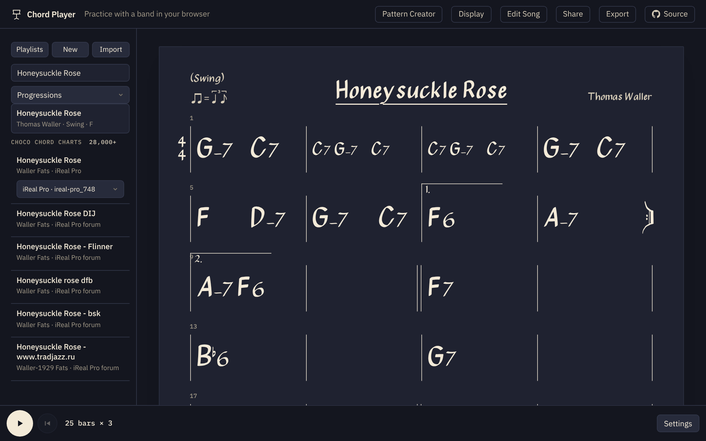
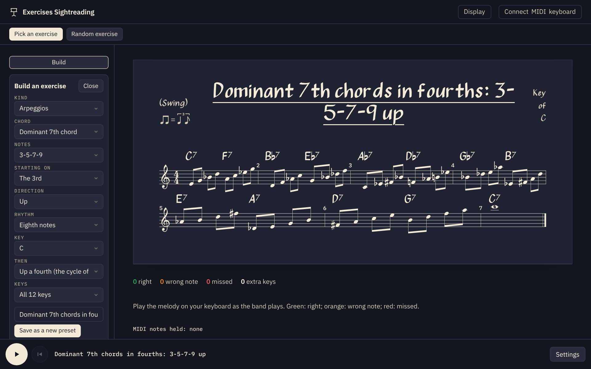
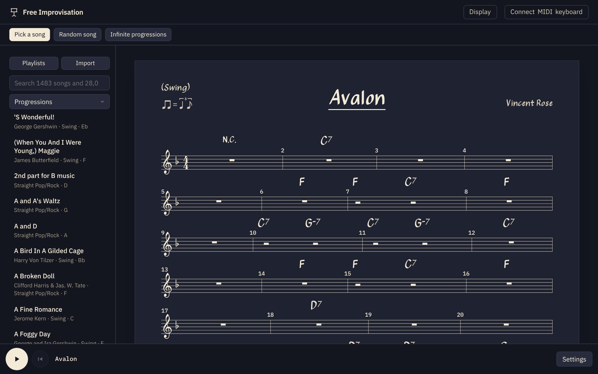
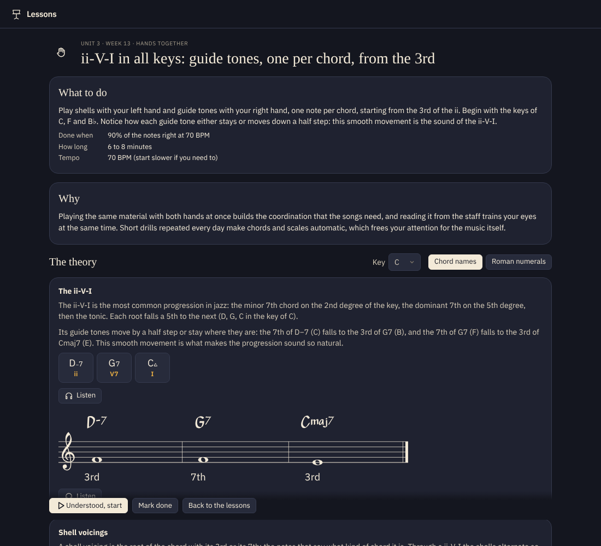

# Piano Practice Companion

An app for practising harmony at the piano with real songs: play along with a band on
**38,307 chord charts**, train your ear to name chord progressions, sight-read
chords and melodies and improvise on a MIDI keyboard, and follow a 46-week
jazz piano program. It runs in a desktop browser and as an Android or iOS app.

The charts come from [ChoCo](https://github.com/smashub/choco), a large open
chord corpus, checked and corrected for this project (see [the data](#the-data)).
The player is a modified version of [OpenStand](https://github.com/canbmaj7/openstand).

**[▶ Try it in your browser](https://dylan-sam.github.io/piano-practice-companion/)**
(no install) · **[Download the Android app](https://github.com/dylan-sam/piano-practice-companion/releases/latest)**




- [What you can do](#what-you-can-do)
- [The data](#the-data)
- [Getting started](#getting-started)
- [Android and iOS apps](#android-and-ios-apps)
- [Publishing the web demo and releases](#publishing-the-web-demo-and-releases)
- [Project layout](#project-layout)
- [Documentation](#documentation)
- [License](#license)
- [Credits](#credits)

## What you can do

The home screen offers **today's lesson**, the practice areas and **your
statistics** (days in a row, time by area, accuracy, what to work on). Everything
is kept on the device; **Delete all my data** erases it, and **Restore all
default songs** brings back the app's songs and example exercises you deleted.
Dark mode, light mode or your own colours are under **Appearance**.

| Area | Screens |
|---|---|
| **Play along** | [Chord Player](#chord-player), [Lead Sheet Player](#lead-sheet-player) |
| **Ear Training** | [Name the progression](#name-the-progression), [Melodic Dictation](#melodic-dictation) |
| **Sightreading** (MIDI keyboard) | [Chord Sightreading](#chord-sightreading), [Lead Sheet Sightreading](#lead-sheet-and-exercises-sightreading), [Exercises Sightreading](#lead-sheet-and-exercises-sightreading), [Lick Sightreading](#lick-sightreading) |
| **Improvisation** (MIDI keyboard) | [Free Improvisation](#free-improvisation) |
| **Lessons** | [a 46-week jazz piano program](#lessons) |


Every screen and option in detail: [docs/EXERCISES.md](docs/EXERCISES.md) and
[studio/README.md](studio/README.md#screens).

### Chord Player

A band (bass, piano, drums) plays any of the 38,307 charts, or one of your own,
so you can play along.

- **Find a song** by title, or by the progressions it contains (a ii-V-I, a
  I-V-vi-IV...).
- **Arrange it**: seven styles (Swing, Jazz Waltz, Bossa Nova, Latin, Ballad,
  Blues, Pop/Rock), 29 piano patterns, any key, tempo and number of choruses,
  or your own groove made in the **Pattern Creator**.
- **Practice**: loop bars, go round the keys, speed up each chorus; a metronome
  and a mixer; pause and go on from the same place.
- **Substitutions**: the band plays chord substitutions (the ii added, the
  tritone substitution, a passing diminished chord...), drawn in blue on the
  sheet with their Roman numerals.
- **Chord helper**: tap a chord to see it on a keyboard with the scales to
  improvise with, and hear them.
- **Your songs and playlists**: write or edit charts, import iReal Pro
  playlists, share a chart as a link, make playlists, export them, and
  download the band as MIDI, WAV or MP3.


### Lead Sheet Player


The same band with a **lead sheet**: the melody on a staff, played by the band.
It comes with **1,479 lead sheets** that may be shared (498 public domain songs
of OpenEWLD and 981 Nottingham folk tunes, see
[docs/DATA.md](docs/DATA.md#lead-sheets-shipped-with-the-app)); more can be
imported from **MusicXML** (MuseScore, or a scanned sheet read by Audiveris).

### Name the progression


Hear a line of a real song with a gap in its chart, and choose the progression
that fills it. Each level adds the next most common progression of the
catalog; 8 right answers in a round of 10 pass the level.

### Melodic Dictation


Hear a few bars of a lead sheet or a lick and write the hidden notes, on the
staff or on a MIDI keyboard. The rhythm is written for you; choose how many
notes to find, with or without notes outside the key.

### Chord Sightreading


Play the chords of a chart on a MIDI keyboard (USB or Bluetooth) while the band
plays: a song, a random song or an endless line of progressions. **Voicing**
turns it into a drill of shells, two-hand, rootless or quartal voicings.

### Lead Sheet and Exercises Sightreading



Read a melody and play it with the band: every note turns green, orange or red,
with your timing. **Scoring** checks the melody, the chords or both hands, the
left hand going from the bass alone to the song's piano pattern.

Exercises Sightreading plays exercises and licks of a few bars. **Build
exercise** makes your own (arpeggios, scales, guide-tone lines through a
progression, approach notes, intervals, rhythm) in any key, saved as presets;
it also lists **175 licks**, mined from the shipped standards or written for
the project ([docs/LICKS.md](docs/LICKS.md)).

### Lick Sightreading


Choose a one-chord lick and a source of chords (a song, a random song or an
endless line): the lick is written and moved over every chord, and you play it
with the band.

### Free Improvisation



Improvise with the band over a song or endless progressions. Every key you play
is written on the sheet and coloured: chord tone, colour tone, approach tone or
outside.

### Lessons


A 46-week jazz piano program of 20 to 30 minutes a day, in nine units (the first
song, the blues, the ii-V-I, the minor ii-V-i, song form, altered dominants, the
minor blues, ballad and bossa, modal playing) and a review. Each week has hands
together, a song learnt in stages, improvising and ear training. Each step has a
page that explains what to do and the theory behind it, with staves and
progressions you can hear, then opens its screen already set up and ticks
itself when the target is reached. Nothing is locked
([docs/LESSONS.md](docs/LESSONS.md)).



## The data

The catalog is a SQLite database (`data/progressions.sqlite`) of 38,307 songs
with their keys, time signatures and 2.5 million chords, each chord stored at
its bar and beat with its length. It is built from:

| Source | Songs |
|---|---|
| [ChoCo v1.0.0](https://github.com/smashub/choco/releases/tag/v1.0.0): Wikifonia, Band-in-a-Box (BiaB), Real Book, Nottingham, When in Rome, Rock Corpus, Jazz Corpus, Schubert Winterreise | 15,141 |
| ChoCo's iReal Pro playlists, read from their original `irealb://` links | 2,064 |
| iReal Pro forum charts collected by ChoCo, curated | 23,223 |
| Duplicate and near-identical versions removed | −2,121 |

**How it was curated.** Only chord charts with a key are kept: ChoCo's
audio-based annotations, the collections it licenses for non-commercial use
only and songs without a key are left out. Exact duplicates and versions at
most two chord edits apart are kept once. A forum chart is kept only when it
brings a new song (or is a popular version posted in several threads);
practice exercises, placeholders and charts of fewer than four bars are left
out.

### How the database stores a song

Every song is one row of the `tracks` table and a list of **events** (chords,
keys, time signatures), each stored at its bar and beat with its length, in one
chord notation for every source ([docs/CHORD_NOTATION.md](docs/CHORD_NOTATION.md)).
Roman numerals are computed from the chords and the key, not stored. The layout
in full: [docs/DATA.md](docs/DATA.md#database-layout).

### What was fixed

ChoCo converts each collection from its original format, and some of these
conversions contain errors. Each collection was checked against its source, and
every fix is made **when ChoCo's files are read** (`import_choco.py`,
`ireal_playlist.py`): nothing is edited by hand, so a rebuild always gives the
same result. The main fixes:

| Problem in ChoCo | Songs | Fix |
|---|---|---|
| Chords on "beat 0" of a bar (Band-in-a-Box) | 2,295 | read as the last beat of the bar before |
| Chord lengths counted in dotted quarters in 6/8 and 12/8 (Wikifonia, Nottingham, When in Rome, Winterreise) | 752 | each collection read with its own way of counting |
| iReal Pro bars shared equally between their chords, and damaged chord symbols (`7alt` became `7at`) | 25,287 | charts read again from their original `irealb://` links, cell by cell |
| Time signatures taken from another song (Real Book) | 142 | 4/4, except the twelve real waltzes |
| Major or minor missing or wrong (Band-in-a-Box, Rock Corpus, Real Book, Wikifonia) | many | taken from another version of the song, or decided by the chords |
| Grace chords of zero length, broken repeat signs | 474 + 273 | dropped, or the chart left out |

Every fix, with its examples and numbers: [docs/DATA.md](docs/DATA.md#corrections-to-choco).

## Getting started

### Requirements

- **Python 3.10** or newer, standard library only (the data and the server).
- **Node.js 22** or newer and **pnpm** (`npm install -g pnpm`) (the app).
- For Chord Sightreading in a desktop browser, a browser with Web MIDI:
  Chrome, Edge or Opera (Firefox asks for a permission; Safari has none).
- About 1 GB of disk space for the ChoCo download and the database.

How to install Node.js and pnpm: see [Android: build it yourself](#android-build-it-yourself).

On Windows, if PowerShell refuses to run `pnpm` ("running scripts is
disabled"), run `Set-ExecutionPolicy -Scope CurrentUser RemoteSigned` once, or
type `pnpm.cmd` instead of `pnpm`.

### 1. Download ChoCo

The database is built from the ChoCo release, too large for this repository.
Download [`v1.0.0.zip`](https://github.com/smashub/choco/releases/download/v1.0.0/v1.0.0.zip)
(187 MB) and save it at the project root as **`choco-v1.0.0.zip`**. The two
other ChoCo files, `choco-ireal-raw-5fe168f.zip` (ChoCo's raw iReal Pro charts)
and `choco-nottingham-bass-5fe168f.zip` (corrected Nottingham basses), are in
the repository.

### 2. Build the data

From the project root:

```sh
python build_database.py        # data/progressions.sqlite (about 2 minutes)
python find_progressions.py     # data/common_progressions.json: the songs of each catalog progression
python build_exercises.py       # studio/public/exercises/: questions of Name the progression
python build_mobile_catalog.py  # studio/public/catalog/: the catalog bundled in the phone apps
```

The files the app reads (`studio/public/exercises/`, `studio/public/catalog/`)
are in the repository, so the phone apps can be built without this step. The
desktop server needs the database.

### 3. Build and run the app

```sh
cd studio
pnpm install
pnpm run build
cd ..
python server.py                # or double-click start.bat on Windows
```

The app opens at <http://127.0.0.1:8765/>. While changing the app, run
`pnpm run dev` in `studio/` for live reload, with `server.py` running for the
song search.

### Tests

```sh
python -m unittest discover     # the data pipeline, from the project root
cd studio
pnpm test                       # the app (vitest)
pnpm run lint
npx playwright install chromium # once, for the browser tests
pnpm run test:e2e               # the browser tests (Playwright) on the built app
```

The browser tests (`studio/e2e/`) open every screen on a computer and on
phones; GitHub runs all the tests on every push (`.github/workflows/tests.yml`).

### Adding your own iReal Pro playlists

Put iReal Pro playlist files (`.txt` or `.html` with `irealb://` links, as
iReal Pro exports them) in `data/ireal-playlists/` and build the data again
(step 2). Their songs join the catalog as "iReal Pro playlists". The app can
also import playlists itself (**Import** in the Chord Player); those
are kept in your browser only.

## Android and iOS apps

The phone apps are the same app in a native shell made with
[Capacitor](https://capacitorjs.com) 8, with the song catalog bundled (no
server needed) and native MIDI input over USB and Bluetooth.

### Android: install the ready-made APK

The quickest way to get the app on an Android phone (Android 7.0 or newer),
with nothing to build:

1. On the phone, open the
   [latest release](https://github.com/dylan-sam/piano-practice-companion/releases/latest)
   and tap `piano-practice-companion-debug.apk` (22 MB) under **Assets**. The
   same file is also in the repository, at
   [`releases/piano-practice-companion-debug.apk`](releases/piano-practice-companion-debug.apk)
   (open the link, then **Download raw file**).
2. Open the downloaded file. Android asks to allow installing apps from your
   browser or file manager: allow it for that app, then tap **Install**.
3. The app appears as **Piano Practice Companion** among your apps.

This APK is a test build of the latest version, signed with a development key
rather than a Play Store key, so Android may warn that the app is from an
unknown developer. To update it, install the newer APK over the old one; if
Android refuses because the signature differs, uninstall the old app first
(your saved tunes and settings are then lost: export your playlists before).

### Android: build it yourself

**Tools to install first** (once):

1. **Node.js 22 or newer** from [nodejs.org](https://nodejs.org) (take the LTS
   version). Node.js runs the JavaScript tools that build the app. Check it in a
   new terminal with `node --version`.
2. **pnpm**, the package manager this project uses (it downloads the
   libraries the app is built with, at the versions of `studio/pnpm-lock.yaml`).
   Install it with npm:

   ```sh
   npm install -g pnpm
   pnpm --version
   ```

   (`corepack enable pnpm` works too.) On Windows, if PowerShell answers that
   running scripts is disabled, run
   `Set-ExecutionPolicy -Scope CurrentUser RemoteSigned` once, or type
   `pnpm.cmd` instead of `pnpm`.
3. **Python 3.10 or newer** from [python.org](https://www.python.org)
   (on Windows, tick "Add python.exe to PATH" in the installer). The build
   uses it to pack the app's source code.
4. **[Android Studio](https://developer.android.com/studio) 2025.2.1 or
   newer.** It includes the Java the build needs (JDK 21) and downloads the
   Android SDK. On its first start, accept the standard setup, and install
   the SDK platform 36 when it asks. Uninstall older Android Studio versions,
   or Gradle may find their old Java.

**Build the app**, from `studio/`:

```sh
pnpm install
pnpm run native     # rebuilds the phone catalog and the app, and copies them into android/ and ios/
pnpm run android    # opens the project in Android Studio
```

Without the database (step 2 skipped), run `pnpm run sync` instead of
`pnpm run native`: it uses the catalog already in `studio/public/catalog/`.

In Android Studio, wait for the Gradle sync to finish, then choose
**Build → Build Bundle(s) / APK(s) → Build APK(s)**. The APK is written to
`studio/android/app/build/outputs/apk/debug/app-debug.apk`: copy it to your
phone and open it (allow installing apps from that source), or connect the
phone with USB debugging on and press **Run**. A Play Store release needs a
signed bundle (**Build → Generate Signed Bundle / APK**).

Run `pnpm run native` (or `pnpm run sync`) again after every change to the app
or the data, before building. Command-line builds and common errors (Java
version, `JAVA_HOME`, PowerShell): [docs/MOBILE.md](docs/MOBILE.md#building).

### iOS (not tested yet)

The Xcode project is in `studio/ios` but has never been built. You need a Mac
with **Xcode 26** or newer and its command line tools
(`xcode-select --install`), and an Apple account to sign the app. The app
targets iOS 15 and later and uses Swift Package Manager (no CocoaPods). From
`studio/`:

```sh
pnpm install
pnpm run native
pnpm run ios        # opens the project in Xcode
```

In Xcode, choose your team under **Signing & Capabilities**, pick a device or a
simulator, and press **Run**. The first build is also the first compile of the
MIDI plugin (`ios/App/App/MidiPlugin.swift`), so expect to fix small errors.
Publishing on the App Store raises a license question: see [License](#license).

How the bundled catalog, native MIDI and phone layouts work:
[docs/MOBILE.md](docs/MOBILE.md).

## Publishing the web demo and releases

Two GitHub Actions workflows publish the app (`.github/workflows/`):

| Workflow | Runs when | Does |
|---|---|---|
| `pages.yml` (Web demo) | every push to `master`, or by hand (Actions → Web demo → Run workflow) | builds the app with the song catalog bundled (`VITE_BUNDLED_CATALOG=1`, no server needed) for the folder `/piano-practice-companion/`, and publishes it on GitHub Pages |
| `tests.yml` (Tests) | every push and pull request | checks the app's types and lint, runs the unit tests, then the browser tests on the app built as for the web demo |
| `release.yml` (Release) | a version tag is pushed (`v1.0.0`, `v1.1.0`...) | creates a GitHub release with `releases/piano-practice-companion-debug.apk` attached, and the notes of `releases/<tag>.md` (or a list of the commits when there is no such file) |

The web demo needs GitHub Pages turned on once: **Settings → Pages → Build and
deployment → Source: GitHub Actions**. To publish a new release, rebuild the APK,
copy it to `releases/piano-practice-companion-debug.apk`, write its notes in
`releases/v1.1.0.md`, commit, then:

```sh
git tag v1.1.0
git push origin master v1.1.0
```

The app can be served from any folder: `BASE_PATH=/my-folder/ pnpm run build`
builds it for `https://example.org/my-folder/` (add `VITE_BUNDLED_CATALOG=1`
when there is no `server.py` behind it).

## Project layout

```
build_database.py        builds data/progressions.sqlite from the sources in data/sources.json
import_choco.py          reads the ChoCo release and corrects its errors
ireal_playlist.py        reads irealb:// charts (repeats, cells) and curates the forum charts
track_store.py           writes songs to the database; settles key modes (key_modes.py)
song_dedupe.py           removes duplicate and near-identical versions
chord_notation.py        the chord, key and Roman numeral notation used everywhere
score_timing.py          bar and beat positions in every meter
common_progressions.py   the catalog progressions; find_progressions.py finds them in the songs
build_exercises.py       questions of Name the progression
build_mobile_catalog.py  the catalog bundled in the phone apps
build_nottingham_fix.py  rebuilds the Nottingham correction file from the ChoCo repository
weimar_playlist.py       turns Weimar Jazz Database solos into lead sheets in weimar/ (test files, not shipped, not in git)
left_hand_patterns.py    the piano patterns (data/left_hand_patterns.json)
server.py                serves the app and the song search on http://127.0.0.1:8765/
score_search.py          song search, versions and their order
studio_bridge.py         turns a song of the database into an app chart
tests/                   Python tests
data/                    sources list, licenses; the database and catalogs once built
weimar/                  Weimar Jazz Database solos and licks for testing (made locally, not in git)
docs/                    documentation and screenshots
studio/                  the app (React, TypeScript, Vite) and its Android and iOS projects
  src/engine/            arranges a chart into MIDI: bass, piano, drums, melody
  src/audio/             synthesizer (SpessaSynth), mixer, MIDI input
  src/music/             chords, charts, melodies and their ABC notation, Roman numerals, practice
  src/exercises/         the practice screens; the exercise builder in src/exercises/builder/
  src/lessons/           the Lessons tab: the program, the step pages and their theory
  scripts/               builds the shipped lead sheets, the licks (docs/LICKS.md) and the app icons
  src/ui/                screens and controls
  src/formats/           iReal Pro import and export, share links
  tests/                 app tests
```

## Documentation

- [docs/DATA.md](docs/DATA.md): sources, database layout, curation, every correction, rebuilding.
- [docs/CHORD_NOTATION.md](docs/CHORD_NOTATION.md): how chords are written, read from iReal Pro cells and played.
- [docs/EXERCISES.md](docs/EXERCISES.md): Name the progression, Melodic Dictation, the four sightreading screens and Free Improvisation in detail.
- [docs/LESSONS.md](docs/LESSONS.md): the Lessons tab, its program, links and sources.
- [docs/LICKS.md](docs/LICKS.md): the licks and exercises, how they are made and mined, and their rights.
- [docs/MOBILE.md](docs/MOBILE.md): the Android and iOS apps, building and troubleshooting.
- [studio/README.md](studio/README.md): the app, its styles and piano patterns.
- [PATTERN_AUDIT.md](PATTERN_AUDIT.md): the piano patterns and their sources.
- [AGENTS.md](AGENTS.md): coding conventions for contributors.

## License

**Code: [GNU AGPL-3.0-or-later](LICENSE).** The app is a modified version of
OpenStand, which is under the AGPL, so the app and the rest of this project's
code are too. You may use, change and share it, also commercially, as long as
everyone who uses your version, including over a network, can get its source
code under the same license. The app links to its own source (`source.zip`)
for that reason.

**Data: [CC BY 4.0](data/LICENSE.md).** The database and the catalogs built
from it (`data/`, `studio/public/catalog/`, `studio/public/exercises/`) are
adapted from ChoCo, which is under CC BY 4.0: you may share and adapt them,
also commercially, if you credit ChoCo (see [Credits](#credits)). The ChoCo
collections licensed for non-commercial use only (CASD, JAAH, Mozart Piano
Sonatas) are not included. The iReal Pro forum charts were contributed by forum
users and are distributed by ChoCo. The catalog holds chord symbols, titles,
composers and keys only: no melodies, lyrics or recordings.

**Licks** ([docs/LICKS.md](docs/LICKS.md#rights-and-credits)): the vocabulary
licks in `studio/public/licks/licks.json` are CC BY 4.0, the licks from
standards public domain. The licks mined from the
Weimar Jazz Database (ODbL 1.0) are not shipped: they are built only in the
`weimar/` folder of your own copy, which git ignores.

**Libraries, sound bank and fonts** keep their own licenses: abcjs (MIT), GeneralUser GS
(`studio/public/soundfonts/GeneralUser-GS-LICENSE.txt`, free to use, also
commercially), Petaluma (`studio/src/assets/fonts/Petaluma-OFL.txt`) and IBM
Plex, both under the SIL Open Font License.

Apple's App Store terms are generally held to be incompatible with the AGPL:
publishing the iOS app there would need the agreement of the OpenStand
authors. Google Play has no such restriction. This is not legal advice.

## Credits

- **Data**: J. de Berardinis, A. Meroño-Peñuela, A. Poltronieri and V. Presutti,
  "ChoCo: a Chord Corpus and a Data Transformation Workflow for Musical Harmony
  Knowledge Graphs", *Scientific Data* 10, 641 (2023).
  [Dataset](https://github.com/smashub/choco), [license](data/CHOCO_LICENSE.md).
  ChoCo gathers collections by their own authors, among them Wikifonia, the
  Band-in-a-Box Internet Corpus, the Real Book, the Nottingham Music Database,
  When in Rome, the Rock Corpus, the Jazz Corpus, Schubert Winterreise and
  iReal Pro charts.
- **Player**: [OpenStand](https://github.com/canbmaj7/openstand)
  (AGPL-3.0-or-later), revision `9d49d2a`, modified for this project
  (see [studio/README.md](studio/README.md)).
- **Synthesizer**: [SpessaSynth](https://github.com/spessasus/SpessaSynth);
  sound bank GeneralUser GS by S. Christian Collins.
- **Music engraving**: [abcjs](https://github.com/paulrosen/abcjs) by Paul Rosen
  and Gregory Dyke (MIT), which draws the lead sheets.
- **Lead sheets**: [OpenEWLD](https://github.com/00sapo/OpenEWLD) by
  F. Simonetta (public domain Wikifonia scores; Discogs data CC0), and the
  Nottingham Music Database by E. Foxley, revised by J. Allwright, as kept by
  ChoCo (CC BY 4.0).
- **Test melodies and test licks** (not shipped): the Weimar Jazz Database (ODbL 1.0),
  M. Pfleiderer, K. Frieler, J. Abesser, W.-G. Zaddach and B. Burkhart (eds.),
  *Inside the Jazzomat: New Perspectives for Jazz Research*, Schott Campus
  (2017). [Jazzomat Research Project](https://jazzomat.hfm-weimar.de/). The
  common patterns follow the Dig That Lick project (K. Frieler, F. Hoeger,
  M. Pfleiderer and S. Dixon, ISMIR 2018).
- **Exercises and lessons**: the triad, interval and rhythm drills and the
  order of the Lessons tab follow K. B. Kelly and E. Rasmussen, *A Guide to
  Exploring Jazz Improvisation - Book 1* (Maricopa Open Digital Press, 2023,
  CC BY 4.0). The lesson songs' left-hand patterns follow J. Siskind, *Playing
  Solo Jazz Piano* (2022), M. Levine, *The Jazz Piano Book* (Sher Music, 1989)
  and E. R. Winn, *How to Play Ragtime* (1913), in our own notes.
- **Ideas** (no code taken): the Check menu of the reading screens (melody,
  chords or both hands) follows the hand choice of
  [PianoBooster](https://github.com/pianobooster/PianoBooster) (GPL); the note
  colours of Free Improvisation follow the note coloration of
  [Impro-Visor](https://github.com/Impro-Visor/Impro-Visor) (GPL-2.0-or-later).
- **Fonts**: Petaluma (Steinberg), IBM Plex (IBM).

This project was built with the help of GPT-6 Sol and Opus 5.5.
