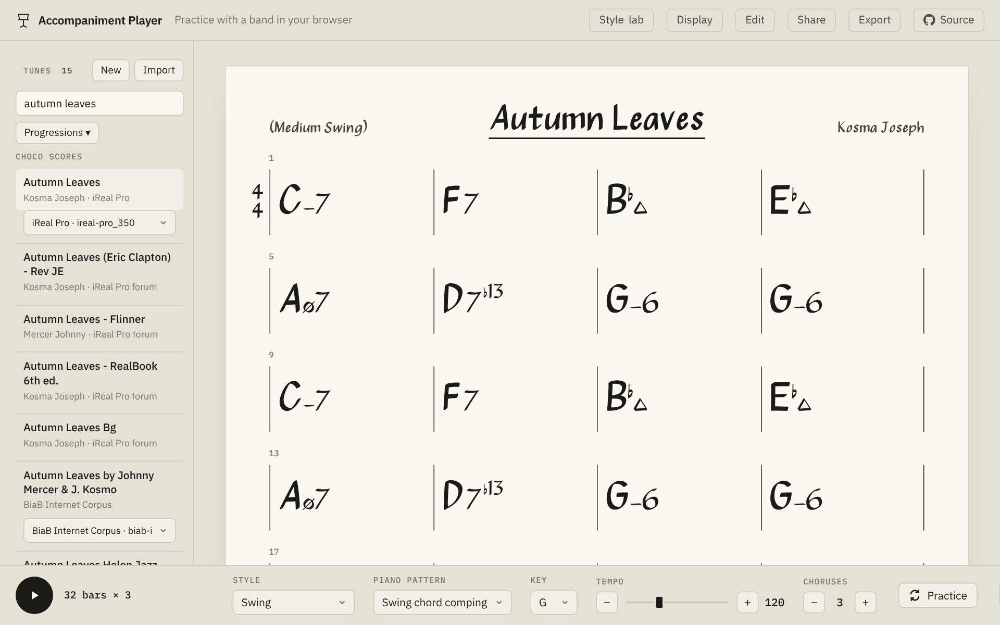
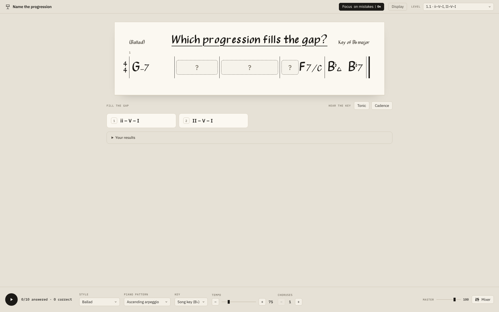
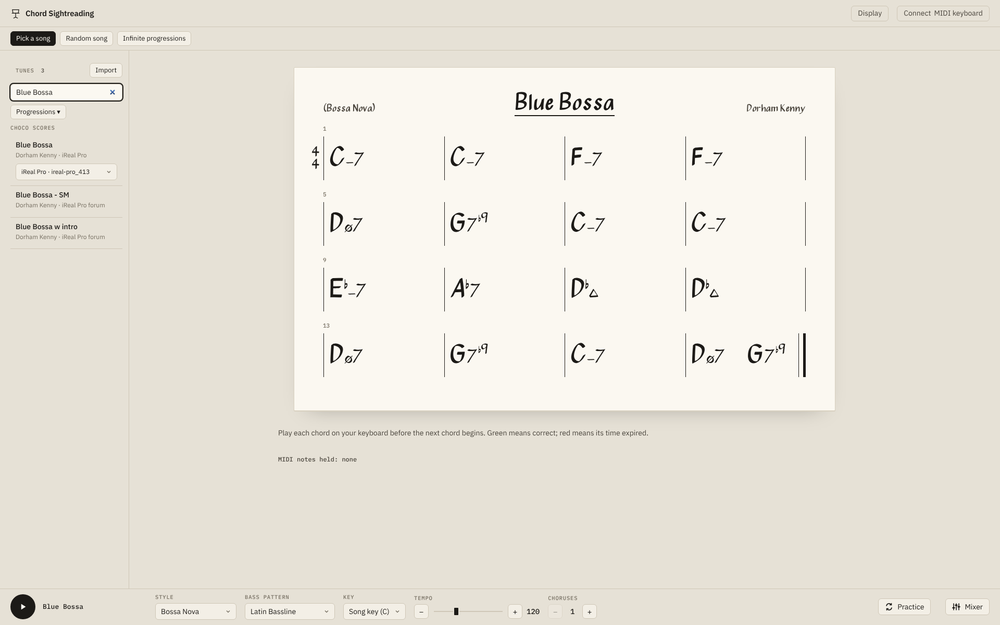
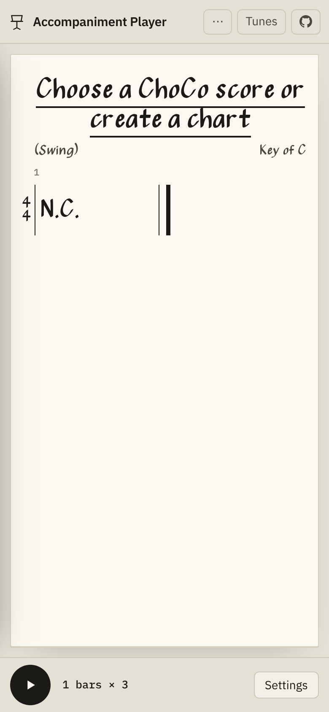

# Piano Practice Companion

An app for practising harmony at the piano with real songs: play along with a band on
**38,307 chord charts**, train your ear to name chord progressions, and
sight-read chords on a MIDI keyboard. It runs in a desktop browser and as an
Android or iOS app.

The charts come from [ChoCo](https://github.com/smashub/choco), a large open
chord corpus, checked and corrected for this project (see [the data](#the-data)).
The player is a modified version of [OpenStand](https://github.com/canbmaj7/openstand).

**[▶ Try it in your browser](https://dylan-sam.github.io/piano-practice-companion/)**
(no install) · **[Download the Android app](https://github.com/dylan-sam/piano-practice-companion/releases/latest)**



- [What you can do](#what-you-can-do)
- [The data](#the-data)
- [Getting started](#getting-started)
- [Android and iOS apps](#android-and-ios-apps)
- [Publishing the web demo and releases](#publishing-the-web-demo-and-releases)
- [Project layout](#project-layout)
- [Documentation](#documentation)
- [License](#license)
- [Credits](#credits)

## What you can do

The app opens on a menu of four screens.

### Chord Accompaniment Player

A band (bass, piano, drums) plays any chart of the catalog, or one of your own, so that you can play along !

- **Find a song**: search the 38,307 charts by title, or choose songs that
  contain chosen progressions (a ii-V-I, a I-V-vi-IV...). A song found in
  several collections offers its versions in a menu, the best one first.
- **Arrange it**: six styles (Swing, Bossa Nova, Latin, Ballad, Blues,
  Straight Pop/Rock), 16 piano patterns, any key, tempo and number of choruses.
- **Style lab**: create your own groove on a step grid (drums, bass, comping),
  keep it, share it as a link and use it as a style in your practice.
- **Practice**: loop a range of bars or a section, go round the keys (up a
  fourth, a half step or a whole step each chorus), speed up each chorus.
- **Mixer**: volume and mute for bass, piano and drums, and a master volume.
- **Auto-scroll**: while the song plays, a long chart scrolls by itself so the
  yellow highlight stays near the middle of the screen, at a speed set by the
  tempo and the number of beats in a row. It can be turned off in the Display
  menu (Sheet auto-scroller On/Off).
- **Display**: Roman numerals (each chord as a degree of the key, following key
  changes), minor written C− or Cm, and % for a bar that repeats the bar before.
- **Your own charts**: write or edit a chart, import iReal Pro links and
  playlists, export your playlists to a file, and share a chart as a link that
  opens in this app or in iReal Pro.
- **Lead sheets too**: a lead sheet (see below) opens here as a chord chart,
  and the band plays it without its melody.

### Lead Sheet Player

The same band plays a **lead sheet**: a chart with a melody, drawn on a staff
with the chords above it. The melody plays with the band (alto sax by default,
or the chart's own instrument) and has its own fader in the Mixer.

- The bar being played gets the yellow highlighter and the note being played
  is coloured; long sheets scroll by themselves.
- The melody follows repeats, loops, transposition and Practice > Keys, with
  the style's swing; every option of the chord player (styles, Practice,
  Style lab, Display) works here too.
- The list holds only tunes that have a melody. The song catalog has chords
  only, so lead sheets are imported: a **MusicXML** file (`.musicxml`, `.xml`
  or `.mxl`, as MuseScore exports it, or a scanned or photographed sheet read
  by Audiveris or homr and checked in MuseScore), or a Studio export. To try it
  with 450 transcribed jazz solos, see
  [Testing lead sheets](docs/DATA.md#testing-lead-sheets-with-the-weimar-jazz-database).

### Name the progression



You hear a line of a real song with a gap in its chart, and choose which
progression fills the gap. The first level asks for the two most common
progressions, and each level adds the next most common progression, based on 
how often it appears in the catalog. 
A round has 10 questions; 8 right answers pass the level. You can play the
key's tonic or a cadence for reference, hear every answer in the gap once you
have answered, hide the key or every chord, choose the key, and turn on
**Focus on mistakes** to be asked more often what you get wrong.

### Chord Sightreading



Connect a MIDI keyboard (USB or Bluetooth) and play the chords of the chart
while bass and drums play along. A chord turns green when you play it in time,
red when its time runs out. Inversions and octave doublings count, and the
fifth of a four-note chord may be left out. Three modes:

- **Pick a song**: any chart of the catalog or of your playlists.
- **Random song**: a random song, if you like one containing a chosen
  progression.
- **Infinite progressions**: an endless line of short progressions chained
  through related keys, with a slider for how often seventh chords appear and
  **Focus on mistakes** for the chords you miss.

Both exercises in detail: [docs/EXERCISES.md](docs/EXERCISES.md).



## The data

The catalog is a SQLite database (`data/progressions.sqlite`) of 38,307 songs
with their keys, time signatures and 2.5 million chords, each chord stored at
its bar and beat with its length. It is built from:

| Source | Songs |
|---|---|
| [ChoCo v1.0.0](https://github.com/smashub/choco/releases/tag/v1.0.0): Wikifonia, Band-in-a-Box (BiaB), Real Book, Nottingham, When in Rome, Rock Corpus, Jazz Corpus, Schubert Winterreise | 15,141 |
| ChoCo's iReal Pro playlists, read from their original `irealb://` links | 2,064 |
| iReal Pro forum charts collected by ChoCo, curated | 23,223 |
| Duplicate and near-identical versions removed | −2,121 |

**How it was curated.** Only chord charts with a key are kept: ChoCo's
audio-based annotations, the collections it licenses for non-commercial use
only and songs without a key are left out. Exact duplicates and versions at
most two chord edits apart are kept once. A forum chart is kept only when it
brings a new song (or is a popular version posted in several threads);
practice exercises, placeholders and charts of fewer than four bars are left
out.

### How the database stores a song

Every song is one row of the `tracks` table (title, artist, composers, genre,
collection, license) and a list of **events** in the `events` table. An event
is a chord, a key or a time signature, and each one is stored with:

| Column | Meaning | Example |
|---|---|---|
| `kind` | what the event is | `chord`, `key` or `timesig` |
| `value` | the chord, key or meter, in one notation for every source ([chord notation](docs/CHORD_NOTATION.md)) | `D:min7`, `C:major`, `4/4` |
| `measure` | the bar number, from 1 (0 for a pickup bar) | `1` |
| `beat` | the beat in that bar, from 1, counted in the meter's own unit: quarter notes in 4/4, eighths in 6/8 or 12/8, so a 12/8 bar has beats 1 to 12 | `3` |
| `onset` | the same position in quarter notes from the start of bar 1, to sort and time events across changes of meter | `2.0` |
| `duration` | the length in quarter notes | `2.0` |
| `ordinal` | the order of the event among the song's chords (or keys, or meters) | `1` |

Bar and beat are two separate numbers, so any beat of any meter can be
written. For example, the start of `| Dm7 G7 | Cmaj7 | Cmaj7 |` in C major,
4/4, is stored as:

| kind | value | measure | beat | onset | duration |
|---|---|---|---|---|---|
| timesig | 4/4 | 1 | 1 | 0 | 12 |
| key | C:major | 1 | 1 | 0 | 12 |
| chord | D:min7 | 1 | 1 | 0 | 2 |
| chord | G:7 | 1 | 3 | 2 | 2 |
| chord | C:maj7 | 2 | 1 | 4 | 8 |

A chord on beat 11 of bar 8 in 12/8 is simply `measure` 8, `beat` 11. Every
source, whatever its own way of writing positions, is converted to this form
when it is read, and the app, the exercises and the progression search only
use this form. Roman numerals are not stored: they are computed from the
chords and the key in force at each chord. More on the layout:
[docs/DATA.md](docs/DATA.md#database-layout).

### What was fixed

ChoCo converts each collection from its original format, and some of these
conversions contain errors. Each collection was checked against its original
source. All the problems below are in **ChoCo's files**, and all the fixes are
made **when those files are read** to build the database (`import_choco.py`
for the ChoCo release, `ireal_playlist.py` for the iReal Pro charts). The
database itself, as described above, has none of these problems. Nothing is
edited by hand, so a rebuild always gives the same result. Each fix gives the
problem, an example, what the import does, and the result in the database.

#### 1. Chords in the wrong place

**Jazz Corpus (76 songs)**

- **Problem:** ChoCo placed every chord where it *ends*, minus one bar,
  instead of where it starts. That is right only for chords lasting exactly
  one bar.
- **Example:** `| Dm7 G7 | Cmaj7 | Cmaj7 |` came out with Dm7 half a bar before
  the song starts, G7 on beat 1 of bar 1, and Cmaj7 in bar 3.
- **Fix:** the chord *lengths* were right, so the chords are laid end to end
  again from bar 1, beat 1, each starting where the one before ends.
- **Now:** Dm7 on bar 1, beat 1; G7 on bar 1, beat 3; Cmaj7 on bar 2 for two
  bars.

**Band-in-a-Box songs in 3/4 and other meters such as 6/8 (95 songs)**

- **Problem:** ChoCo moved from one chord to the next as if every bar had 4
  beats, so in other meters the chords drift away from their beats.
- **Example:** in a waltz with one chord per bar, the second chord was on
  beat 2 of bar 2, and the next ones went on drifting.
- **Fix:** the lengths were right here too, so the chords are laid end to end
  again. Songs in 4/4 and 2/2 were right and are kept as they are.
- **Now:** one chord on beat 1 of every bar, as in the original song.

**Beats 10 to 12 of 12/8 bars (781 chords in 98 songs)**

- **Problem:** in its files, ChoCo writes a position as a single number,
  bar + beat / 10: bar 8, beat 3 is `8.3`. That works for beats 1 to 9 only.
  A 12/8 bar has 12 beats, and beats 10, 11 and 12 overflow into the next
  bar's number.
- **Example:** bar 8, beat 10 is written `8 + 10/10 = 9.0`, and bar 8, beat 11
  `8 + 11/10 = 9.1`, which looks exactly like bar 9, beat 1. Read naively, the
  chord jumps to the next bar.
- **Fix:** the number alone cannot tell the two apart, so the import looks at
  the chord before, whose position and length are known. Take bar 8 of a 12/8
  song: chord A starts on beat 1 and lasts 10 beats, so it ends on beat 11.
  The next chord, B, is written `9.1`. Had A ended on bar 9, beat 1, it would
  have lasted 12 beats, not 10. So B is not on bar 9: it starts where A ends,
  on bar 8, beat 11. In short, when a chord is written at the position where
  the previous chord's end would overflow (beat 10 or more), it is put back on
  that beat of the previous bar. When the numbers do match bar 9, the chord
  stays on bar 9.
- **Now:** B is stored with `measure` 8 and `beat` 11, right after A, as in
  the original score. This guess is needed only because the information is
  lost in ChoCo's files; the database writes bar and beat separately, so the
  problem cannot happen again once a song is stored.

**Beat 0 in Band-in-a-Box bars**

- **Problem:** some Band-in-a-Box chords on the last beat of a bar are written
  as beat 0 of the next bar. Beats start at 1, so beat 0 does not exist.
- **Example:** in 4/4, `3.0` (bar 3, beat 0) stands for bar 2, beat 4.
- **Fix:** beat 0 of a bar is read as the last beat of the bar before.
- **Now:** the chord sits on bar 2, beat 4.

#### 2. Chords with the wrong length

**Wikifonia, Nottingham, When in Rome, Schubert Winterreise**

- **Problem:** these collections count beats as the music21 library does: in
  6/8, 9/8 or 12/8 a beat is a dotted quarter (three eighths), so a 6/8 bar
  has 2 beats and a 12/8 bar 4. Read in eighths, as the other collections
  are, every length came out three times too short and chords after beat 1
  moved towards the start of the bar. When in Rome gives its lengths in
  quarter notes even in 2/2, where its beats are half notes.
- **Example:** a 6/8 tune with one chord per bar has lengths of "2 beats"
  (the whole bar). Read as 2 eighths, each chord lasted a third of its bar,
  followed by a false "no chord" gap of 4 eighths; a chord on the second beat
  (the fourth eighth) was put on the second eighth. A When in Rome chord of a
  whole 2/2 bar lasted two bars.
- **Fix:** each collection is read with its own way of counting
  (`import_choco.COUNTING`), and lengths are converted bar by bar, so a
  chord that crosses a change of meter is right too.
- **Now:** the 6/8 chord lasts its whole bar (6 eighths), with no gap. In every
  collection, 99 to 100 % of chords start exactly where the one before ends.

**iReal Pro charts (25,287 charts)**

- **Problem:** iReal Pro places chords on a grid of cells, and a chord lasts
  until the next one, as the app plays it. ChoCo ignored the cells and shared
  each bar equally between its chords.
- **Example:** the 4/4 bar `F Abo,G-7` is played by iReal Pro as F for 2
  beats, then Abo and G-7 for 1 beat each. ChoCo gave all three 1 1/3 beats.
- **Fix:** the charts are read again from their original iReal Pro links
  (`irealb://`), cell by cell
  ([details](docs/CHORD_NOTATION.md#chord-lengths-in-ireal-bars)).
- **Now:** F on beat 1 for 2 beats, Abo on beat 3, G-7 on beat 4. When a bar
  really is split evenly (three chords in four beats), the app writes a
  triplet bracket over them.

#### 3. Wrong time signatures

**Real Book (142 songs)**

- **Problem:** ChoCo took each song's time signature from a separate table,
  matched by a number it generated itself, so many songs got another song's
  meter. The chords themselves are always written in bars of 4 beats.
- **Example:** *Belle of the Ball*, a waltz, was in 4/4, and 12 songs in 4/4
  were in 3/4.
- **Fix:** every Real Book song is read in 4/4, except the twelve waltzes of
  ChoCo's own table, whose chords are rescaled to bars of 3 beats (a chord of
  4 beats becomes 3, two chords of 2 beats become 1 1/2 each).
- **Now:** *Belle of the Ball* is in 3/4 and the 4/4 songs are in 4/4.

#### 4. Wrong or missing keys

**Jazz Corpus chords written in C (76 songs)**

- **Problem:** the corpus writes every song transposed to C, with the song's
  real key beside it. ChoCo kept both, so the chords did not match their key.
  The keys were also misspelt (`C:majoror`).
- **Example:** a song in F was stored as `Dm7 G7 C` in the key of F, which
  reads as vi-ii-V instead of ii-V-I.
- **Fix:** every chord is transposed from C to the song's key, and the key is
  spelt correctly.
- **Now:** `Gm7 C7 F` in F, a ii-V-I.

**Major or minor missing or wrong (Band-in-a-Box, Rock Corpus, Real Book, Wikifonia)**

- **Problem:** Band-in-a-Box and the Rock Corpus give only the key's note (C,
  not C major or C minor). The Real Book and Wikifonia mark many minor songs as
  major: Wikifonia takes its keys from the key signature, which is the same for
  a major key and its relative minor.
- **Example:** a Wikifonia song in C minor (three flats) was labelled E♭
  major; a Band-in-a-Box blues in G minor was just "G".
- **Fix:** the mode is taken from another version of the same song whose mode
  is known (iReal Pro marks it reliably). Otherwise the chords decide: the
  time spent on the major and minor tonic chords (C and Cm), and for
  Wikifonia on the relative minor (Cm in E♭). The thresholds were checked on
  songs whose mode is known (94 to 99 % agreement).
- **Now:** the Wikifonia song is in C minor, the blues in G minor. 821 of
  43,126 keys stay undecided and keep only their note; the app then shows
  "(major or minor)".

**No key at all (38 songs)**

- **Problem:** a few entries have no key, which the Roman numerals and the
  exercises need.
- **Fix and now:** they are left out of the catalog.

#### 5. Wrong chord symbols

**Nottingham slash chords (445 chords in 82 tunes)**

- **Problem:** the tunes write a sharp bass as `+` (ABC notation), and ChoCo
  dropped the sharp.
- **Example:** `D/f+` (D with F♯ in the bass) was stored as D/F.
- **Fix:** the chords are read again from the original tunes, and the
  corrected chords are kept in `choco-nottingham-bass-5fe168f.zip`
  (rebuilt by `build_nottingham_fix.py`).
- **Now:** D/F♯.

**iReal Pro chord symbols**

- **Problem:** ChoCo's conversion of iReal Pro charts damaged chord symbols.
- **Example:** `F*maj7*` (a chord with custom text) became `Faj7`, `7alt`
  became `7at`, `Dh7` (D half-diminished) became D♭7, `7#11` gained a ninth,
  and `7b9#9` became a major seventh.
- **Fix:** the charts are read again from their original iReal Pro links with
  this project's own reader (`ireal_playlist.py`).
- **Now:** every chord as written in the chart: Fmaj7, 7alt, Dø7, 7♯11 (no added ninth) and 7♭9♯9 (a dominant chord).

#### 6. Entries that cannot be played

**Grace chords (2,504 chords, mostly Wikifonia)**

- **Problem:** a chord of zero length, followed by another chord at the same
  place. It never sounds, but it showed in the chart and in the exercises.
- **Fix:** it is dropped; an entry left with no chord at all is left out.
- **Now:** only the chord that sounds remains.

**Endless Nottingham tunes (6 tunes)**

- **Problem:** ChoCo writes out each tune's repeats, and for six tunes this
  went wrong and produced 1,000 to 2,000 bars.
- **Fix:** tunes over 500 bars are left out (the longest correct tune is far
  shorter).
- **Now:** no tune in the catalog runs on for thousands of bars.

**Broken repeat signs (273 forum charts)**

- **Problem:** a repeat sign that is opened but never closed, or closed but
  never opened, makes the chart repeat thousands of times when its repeats are
  written out.
- **Fix:** a chart whose repeats would make it more than four times its
  written length is not imported, and the import log says why.
- **Now:** these charts are left out, and the import log lists them with
  the reason.

**Missing titles (76 Jazz Corpus songs)**

- **Problem:** the Jazz Corpus has no titles, and the empty titles made the
  songs look like duplicates of each other (and of songs whose title is in
  another alphabet).
- **Fix:** they are named "Jazz Corpus sequence 1", "Jazz Corpus sequence 2"...,
  and titles in other alphabets (Greek, Cyrillic, Japanese) are compared
  letter by letter instead of as empty text.
- **Now:** every song has a title and stays separate in the search.

Every chord is then written in one notation
([chord notation](docs/CHORD_NOTATION.md)). The full account, with the numbers
behind each fix: [docs/DATA.md](docs/DATA.md).

## Getting started

### Requirements

- **Python 3.10** or newer, standard library only (the data and the server).
- **Node.js 22** or newer and **pnpm** (`npm install -g pnpm`) (the app).
- For Chord Sightreading in a desktop browser, a browser with Web MIDI:
  Chrome, Edge or Opera (Firefox asks for a permission; Safari has none).
- About 1 GB of disk space for the ChoCo download and the database.

What Node.js and pnpm are, and how to install them: see the
[tools to install](#android) for the Android app, the same for every use.

On Windows, if PowerShell refuses to run `pnpm` ("running scripts is
disabled"), run `Set-ExecutionPolicy -Scope CurrentUser RemoteSigned` once, or
type `pnpm.cmd` instead of `pnpm`.

### 1. Download ChoCo

The database is built from the ChoCo release, too large for this repository.
Download [`v1.0.0.zip`](https://github.com/smashub/choco/releases/download/v1.0.0/v1.0.0.zip)
(187 MB) and save it at the project root as **`choco-v1.0.0.zip`**. The two
other ChoCo files, `choco-ireal-raw-5fe168f.zip` (ChoCo's raw iReal Pro charts)
and `choco-nottingham-bass-5fe168f.zip` (corrected Nottingham basses), are in
the repository.

### 2. Build the data

From the project root:

```sh
python build_database.py        # data/progressions.sqlite (about 2 minutes)
python find_progressions.py     # data/common_progressions.json: the songs of each catalog progression
python build_exercises.py       # studio/public/exercises/: questions of Name the progression
python build_mobile_catalog.py  # studio/public/catalog/: the catalog bundled in the phone apps
```

The files the app reads (`studio/public/exercises/`, `studio/public/catalog/`)
are in the repository, so the phone apps can be built without this step. The
desktop server needs the database.

### 3. Build and run the app

```sh
cd studio
pnpm install
pnpm run build
cd ..
python server.py                # or double-click start.bat on Windows
```

The app opens at <http://127.0.0.1:8765/>. While changing the app, run
`pnpm run dev` in `studio/` for live reload, with `server.py` running for the
song search.

### Tests

```sh
python -m unittest discover     # the data pipeline, from the project root
cd studio
pnpm test                       # the app (vitest)
pnpm run lint
```

### Adding your own iReal Pro playlists

Put iReal Pro playlist files (`.txt` or `.html` with `irealb://` links, as
iReal Pro exports them) in `data/ireal-playlists/` and build the data again
(step 2). Their songs join the catalog as "iReal Pro playlists". The app can
also import playlists itself (**Import** in the Chord Accompaniment Player); those
are kept in your browser only.

## Android and iOS apps

The phone apps are the same app in a native shell made with
[Capacitor](https://capacitorjs.com) 8, with the song catalog bundled (no
server needed) and native MIDI input over USB and Bluetooth.

### Android: install the ready-made APK

The quickest way to get the app on an Android phone (Android 7.0 or newer),
with nothing to build:

1. On the phone, open the
   [latest release](https://github.com/dylan-sam/piano-practice-companion/releases/latest)
   and tap `piano-practice-companion-debug.apk` (23 MB) under **Assets**. The
   same file is also in the repository, at
   [`releases/piano-practice-companion-debug.apk`](releases/piano-practice-companion-debug.apk)
   (open the link, then **Download raw file**).
2. Open the downloaded file. Android asks to allow installing apps from your
   browser or file manager: allow it for that app, then tap **Install**.
3. The app appears as **Ear Training** among your apps.

This APK is a test build of the latest version, signed with a development key
rather than a Play Store key, so Android may warn that the app is from an
unknown developer. To update it, install the newer APK over the old one; if
Android refuses because the signature differs, uninstall the old app first
(your saved tunes and settings are then lost: export your playlists before).

### Android: build it yourself

**Tools to install first** (once):

1. **Node.js 22 or newer** from [nodejs.org](https://nodejs.org) (take the LTS
   version). Node.js runs the JavaScript tools that build the app. Check it in a
   new terminal with `node --version`.
2. **pnpm**, the package manager this project uses. A package manager
   downloads the libraries the app is built with (React, Vite, Capacitor and
   about 300 others) into `studio/node_modules/`, at the exact versions listed
   in `studio/pnpm-lock.yaml`, and runs the project's commands
   (`pnpm run build`...). It does the same job as npm, which comes with Node.js,
   but is faster and saves disk space. Install it with npm:

   ```sh
   npm install -g pnpm
   pnpm --version
   ```

   (`corepack enable pnpm` works too.) On Windows, if PowerShell answers that
   running scripts is disabled, run
   `Set-ExecutionPolicy -Scope CurrentUser RemoteSigned` once, or type
   `pnpm.cmd` instead of `pnpm`.
3. **Python 3.10 or newer** from [python.org](https://www.python.org)
   (on Windows, tick "Add python.exe to PATH" in the installer). The build
   uses it to pack the app's source code.
4. **[Android Studio](https://developer.android.com/studio) 2025.2.1 or
   newer.** It includes the Java the build needs (JDK 21) and downloads the
   Android SDK. On its first start, accept the standard setup, and install
   the SDK platform 36 when it asks. Uninstall older Android Studio versions,
   or Gradle may find their old Java.

**Build the app**, from `studio/`:

```sh
pnpm install
pnpm run native     # rebuilds the phone catalog and the app, and copies them into android/ and ios/
pnpm run android    # opens the project in Android Studio
```

Without the database (step 2 skipped), run `pnpm run sync` instead of
`pnpm run native`: it uses the catalog already in `studio/public/catalog/`.

In Android Studio, wait for the Gradle sync to finish, then choose
**Build → Build Bundle(s) / APK(s) → Build APK(s)**. The APK is written to
`studio/android/app/build/outputs/apk/debug/app-debug.apk`: copy it to your
phone and open it (allow installing apps from that source), or connect the
phone with USB debugging on and press **Run**. A Play Store release needs a
signed bundle (**Build → Generate Signed Bundle / APK**).

Run `pnpm run native` (or `pnpm run sync`) again after every change to the app
or the data, before building. Command-line builds and common errors (Java
version, `JAVA_HOME`, PowerShell): [docs/MOBILE.md](docs/MOBILE.md#building).

### iOS (not tested yet)

The Xcode project is in `studio/ios` but has never been built. You need a Mac
with **Xcode 26** or newer and its command line tools
(`xcode-select --install`), and an Apple account to sign the app. The app
targets iOS 15 and later and uses Swift Package Manager (no CocoaPods). From
`studio/`:

```sh
pnpm install
pnpm run native
pnpm run ios        # opens the project in Xcode
```

In Xcode, choose your team under **Signing & Capabilities**, pick a device or a
simulator, and press **Run**. The first build is also the first compile of the
MIDI plugin (`ios/App/App/MidiPlugin.swift`), so expect to fix small errors.
Publishing on the App Store raises a license question: see [License](#license).

How the bundled catalog, native MIDI and phone layouts work:
[docs/MOBILE.md](docs/MOBILE.md).

## Publishing the web demo and releases

Two GitHub Actions workflows publish the app (`.github/workflows/`):

| Workflow | Runs when | Does |
|---|---|---|
| `pages.yml` (Web demo) | every push to `master`, or by hand (Actions → Web demo → Run workflow) | builds the app with the song catalog bundled (`VITE_BUNDLED_CATALOG=1`, no server needed) for the folder `/piano-practice-companion/`, and publishes it on GitHub Pages |
| `release.yml` (Release) | a version tag is pushed (`v1.0.0`, `v1.1.0`...) | creates a GitHub release with `releases/piano-practice-companion-debug.apk` attached, and the notes of `releases/<tag>.md` (or a list of the commits when there is no such file) |

The web demo needs GitHub Pages turned on once: **Settings → Pages → Build and
deployment → Source: GitHub Actions**. To publish a new release, rebuild the APK,
copy it to `releases/piano-practice-companion-debug.apk`, write its notes in
`releases/v1.1.0.md`, commit, then:

```sh
git tag v1.1.0
git push origin master v1.1.0
```

The app can be served from any folder: `BASE_PATH=/my-folder/ pnpm run build`
builds it for `https://example.org/my-folder/` (add `VITE_BUNDLED_CATALOG=1`
when there is no `server.py` behind it).

## Project layout

```
build_database.py        builds data/progressions.sqlite from the sources in data/sources.json
import_choco.py          reads the ChoCo release and corrects its errors
ireal_playlist.py        reads irealb:// charts (repeats, cells) and curates the forum charts
track_store.py           writes songs to the database; settles key modes (key_modes.py)
song_dedupe.py           removes duplicate and near-identical versions
chord_notation.py        the chord, key and Roman numeral notation used everywhere
score_timing.py          bar and beat positions in every meter
common_progressions.py   the catalog progressions; find_progressions.py finds them in the songs
build_exercises.py       questions of Name the progression
build_mobile_catalog.py  the catalog bundled in the phone apps
build_nottingham_fix.py  rebuilds the Nottingham correction file from the ChoCo repository
weimar_playlist.py       turns Weimar Jazz Database solos into lead sheets to test the app (not shipped)
left_hand_patterns.py    the piano patterns (data/left_hand_patterns.json)
server.py                serves the app and the song search on http://127.0.0.1:8765/
score_search.py          song search, versions and their order
studio_bridge.py         turns a song of the database into an app chart
tests/                   Python tests
data/                    sources list, licenses; the database and catalogs once built
docs/                    documentation and screenshots
studio/                  the app (React, TypeScript, Vite) and its Android and iOS projects
  src/engine/            arranges a chart into MIDI: bass, piano, drums, melody
  src/audio/             synthesizer (SpessaSynth), mixer, MIDI input
  src/music/             chords, charts, melodies and their ABC notation, Roman numerals, practice
  src/exercises/         Name the progression and Chord Sightreading
  src/ui/                screens and controls
  src/formats/           iReal Pro import and export, share links
  tests/                 app tests
```

## Documentation

- [docs/DATA.md](docs/DATA.md): sources, database layout, curation, every correction, rebuilding.
- [docs/CHORD_NOTATION.md](docs/CHORD_NOTATION.md): how chords are written, read from iReal Pro cells and played.
- [docs/EXERCISES.md](docs/EXERCISES.md): Name the progression and Chord Sightreading in detail.
- [docs/MOBILE.md](docs/MOBILE.md): the Android and iOS apps, building and troubleshooting.
- [studio/README.md](studio/README.md): the app, its styles and piano patterns.
- [PATTERN_AUDIT.md](PATTERN_AUDIT.md): the piano patterns and their sources.
- [AGENTS.md](AGENTS.md): coding conventions for contributors.

## License

**Code: [GNU AGPL-3.0-or-later](LICENSE).** The app is a modified version of
OpenStand, which is under the AGPL, so the app and the rest of this project's
code are too. You may use, change and share it, also commercially, as long as
everyone who uses your version, including over a network, can get its source
code under the same license. The app links to its own source (`source.zip`)
for that reason.

**Data: [CC BY 4.0](data/LICENSE.md).** The database and the catalogs built
from it (`data/`, `studio/public/catalog/`, `studio/public/exercises/`) are
adapted from ChoCo, which is under CC BY 4.0: you may share and adapt them,
also commercially, if you credit ChoCo (see [Credits](#credits)). The ChoCo
collections licensed for non-commercial use only (CASD, JAAH, Mozart Piano
Sonatas) are not included. The iReal Pro forum charts were contributed by forum
users and are distributed by ChoCo. The catalog holds chord symbols, titles,
composers and keys only: no melodies, lyrics or recordings.

**Libraries, sound bank and fonts** keep their own licenses: abcjs (MIT), GeneralUser GS
(`studio/public/soundfonts/GeneralUser-GS-LICENSE.txt`, free to use, also
commercially), Petaluma (`studio/src/assets/fonts/Petaluma-OFL.txt`) and IBM
Plex, both under the SIL Open Font License.

Apple's App Store terms are generally held to be incompatible with the AGPL:
publishing the iOS app there would need the agreement of the OpenStand
authors. Google Play has no such restriction. This is not legal advice.

## Credits

- **Data**: J. de Berardinis, A. Meroño-Peñuela, A. Poltronieri and V. Presutti,
  "ChoCo: a Chord Corpus and a Data Transformation Workflow for Musical Harmony
  Knowledge Graphs", *Scientific Data* 10, 641 (2023).
  [Dataset](https://github.com/smashub/choco), [license](data/CHOCO_LICENSE.md).
  ChoCo gathers collections by their own authors, among them Wikifonia, the
  Band-in-a-Box Internet Corpus, the Real Book, the Nottingham Music Database,
  When in Rome, the Rock Corpus, the Jazz Corpus, Schubert Winterreise and
  iReal Pro charts.
- **Player**: [OpenStand](https://github.com/canbmaj7/openstand)
  (AGPL-3.0-or-later), revision `9d49d2a`, modified for this project
  (see [studio/README.md](studio/README.md)).
- **Synthesizer**: [SpessaSynth](https://github.com/spessasus/SpessaSynth);
  sound bank GeneralUser GS by S. Christian Collins.
- **Music engraving**: [abcjs](https://github.com/paulrosen/abcjs) by Paul Rosen
  and Gregory Dyke (MIT), which draws the lead sheets.
- **Test melodies** (not shipped): the Weimar Jazz Database, M. Pfleiderer,
  K. Frieler, J. Abesser, W.-G. Zaddach and B. Burkhart (eds.), *Inside the
  Jazzomat: New Perspectives for Jazz Research*, Schott Campus (2017).
  [Jazzomat Research Project](https://jazzomat.hfm-weimar.de/).
- **Fonts**: Petaluma (Steinberg), IBM Plex (IBM).

This project was built with the help of GPT-6 Sol and Opus 5.5.
